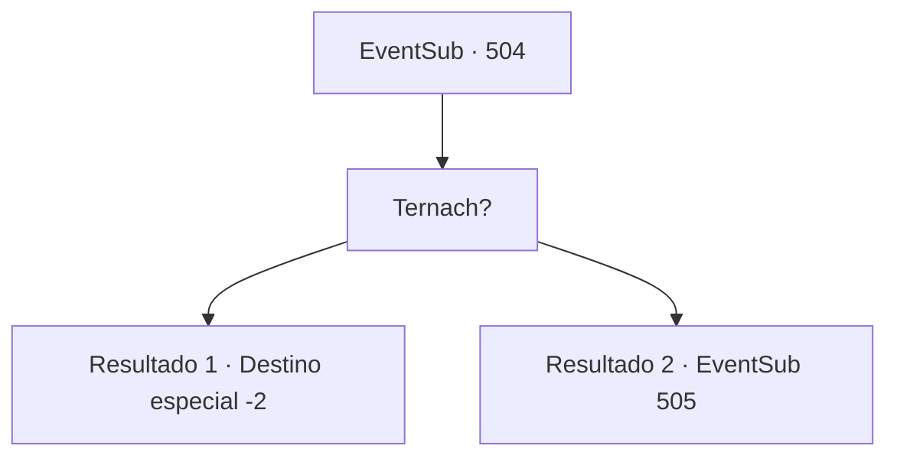

# Eventos secundários · 504

[Índice da tabela](index.md) · [Índice geral](../index.md)

ID: `pt:EventSub:504` · Fonte: `EventSub4` · Versão: 1.2.47.

Mapeamento estático dos arquivos; a disponibilidade e a execução dependem do estado da run.

## Texto do evento

*Sem texto no arquivo.*

## Dados de entrada

```json
{
  "id": 504,
  "grade": 1,
  "subEvent": "",
  "required": ""
}
```

## Mapa das escolhas



## Escolhas e resultados

### Escolha 1

Ternach?

Requisitos e outros campos da escolha:

```json
{
  "required": ""
}
```

#### Resultado 1.1

Ternach te coloca no chão e fala com você. 

 "Você sabe o quanto eu perderia se a deixasse ir? ...Isso é o suficiente. Eu vou embora."

 Ternach decola e voa alto no céu. Quando Ternach se vai, as pessoas começam a se aproximar de você, chocadas com a aparição do Dragão Azul. Leva muito tempo para você conseguir se abrir caminho entre elas.

Continuação registrada: [Destino especial `-2`](../destinos-especiais.md).

```json
{
  "required": "18_456_2",
  "chance": "1",
  "nextEvent": -2,
  "type": 2,
  "reward": "12_9_4"
}
```

#### Resultado 1.2

Ternach te coloca no chão e fala com você. 

 "Você sabe o quanto eu perderia se a deixasse ir? ...Isso é o suficiente. Eu vou embora."

 Ternach decola e voa alto no céu. Quando Ternach se vai, as pessoas começam a se aproximar de você, chocadas com a aparição do Dragão Azul. Elas fazem perguntas sobre dragões e sobre sua relação com eles. Você ignora as perguntas de todos. Mas o anão mensageiro que você conheceu antes, 'Farnan', te reconhece e grita sobre a multidão. 

 "Você... Você encontrou o dragão e conversou com ele! Uau! O que o dragão disse?"


Continuação registrada: [Evento 505](0505.md) na mesma tabela.

```json
{
  "required": "5_456_2",
  "chance": "1",
  "nextEvent": 505,
  "type": 2,
  "reward": ""
}
```

## Referências que chegam a este evento

- [Evento 502 · escolha 2 · resultado 1](0502.md#escolha-2)
