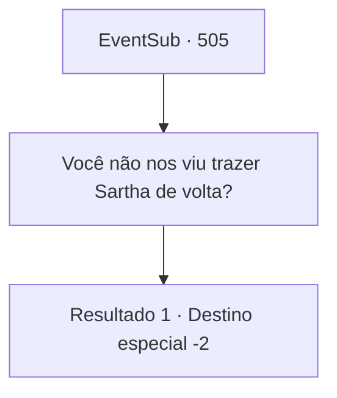

# Eventos secundários · 505

[Índice da tabela](index.md) · [Índice geral](../index.md)

ID: `pt:EventSub:505` · Fonte: `EventSub4` · Versão: 1.2.47.

Mapeamento estático dos arquivos; a disponibilidade e a execução dependem do estado da run.

## Texto do evento

*Sem texto no arquivo.*

## Dados de entrada

```json
{
  "id": 505,
  "grade": 1,
  "subEvent": "",
  "required": ""
}
```

## Mapa das escolhas



## Escolhas e resultados

### Escolha 1

Você não nos viu trazer Sartha de volta?

Requisitos e outros campos da escolha:

```json
{
  "required": ""
}
```

#### Resultado 1.1

Você pergunta a ele como ele não percebeu que você acabou de trazer Sartha de volta para a cidade.  Ele parece surpreso com essa notícia e continua falando. 

 "Oh...? Você convenceu o dragão a deixar a senhora Sartha ir? Onde ela está agora? Eu não a vi porque fiquei tão surpreso com o dragão!"

 Ele olha ao redor apressadamente, até que algo parece ocorrer a ele e ele exclama 'Ah'! 

 "Oh meu. Pe... Pegue isso. Eu prometi que te recompensaria!"

 Ele coloca algo em sua mochila e então se apressa para encontrar Sartha.

Continuação registrada: [Destino especial `-2`](../destinos-especiais.md).

```json
{
  "required": "",
  "chance": "1",
  "nextEvent": -2,
  "type": 2,
  "reward": "3_179_1|12_9_4"
}
```

## Referências que chegam a este evento

- [Evento 504 · escolha 1 · resultado 2](0504.md#escolha-1)
