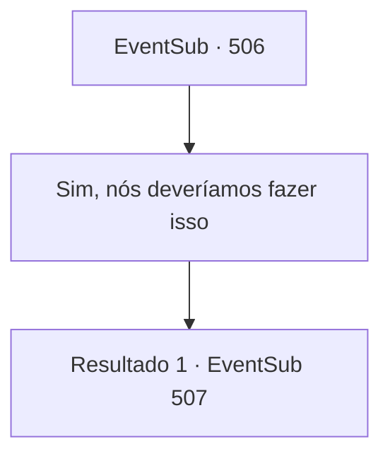

# Eventos secundários · 506

[Índice da tabela](index.md) · [Índice geral](../index.md)

ID: `pt:EventSub:506` · Fonte: `EventSub4` · Versão: 1.2.47.

Mapeamento estático dos arquivos; a disponibilidade e a execução dependem do estado da run.

## Texto do evento

*Sem texto no arquivo.*

## Dados de entrada

```json
{
  "id": 506,
  "grade": 1,
  "subEvent": "",
  "required": ""
}
```

## Mapa das escolhas



## Escolhas e resultados

### Escolha 1

Sim, nós deveríamos fazer isso

Requisitos e outros campos da escolha:

```json
{
  "required": ""
}
```

#### Resultado 1.1

Você e Ternach voam pelo céu limpo. As nuvens flutuando sob seus pés parecem algodão doce. |drawing_flywithDragon| Quando você decolou, o sol estava suspenso diretamente acima, mas agora começou a se pôr no oeste. 

 "Devemos descer agora?"

 Ternach pousa cuidadosa e graciosamente. Você se encontra em uma colina com vista para uma pequena vila. Ternach assume uma forma humana e olha para você antes de falar. 

 "Hm. Aventureiro, como você gostou do voo?"

 Você pode perceber que Ternach está tentando imitar um guia na Guilda dos Aventureiros, mas o sotaque não está totalmente certo.

Continuação registrada: [Evento 507](0507.md) na mesma tabela.

```json
{
  "required": "",
  "chance": "1",
  "nextEvent": 507,
  "type": 2,
  "reward": ""
}
```

## Referências que chegam a este evento

- [Evento 503 · escolha 1 · resultado 1](0503.md#escolha-1)
- [Evento 503 · escolha 1 · resultado 2](0503.md#escolha-1)
