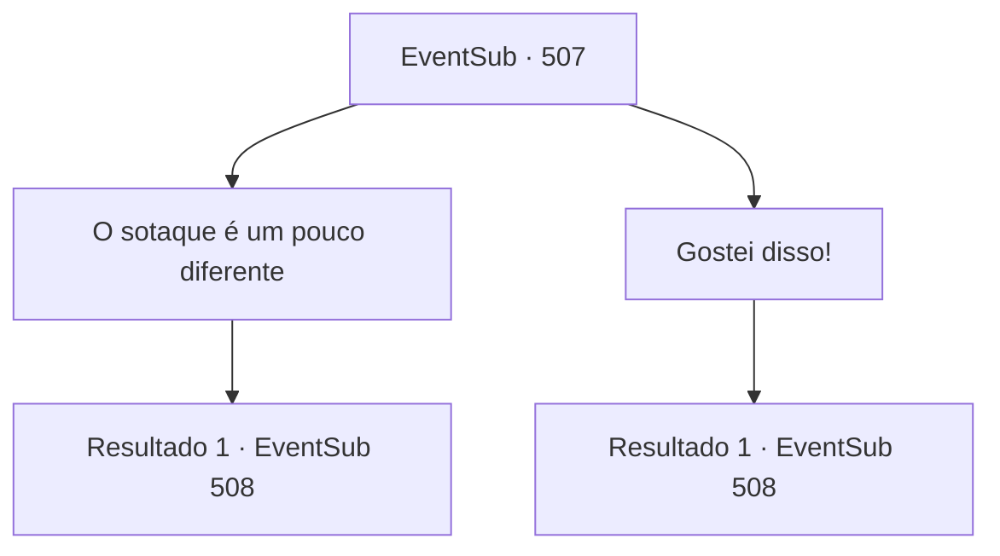

# Eventos secundários · 507

[Índice da tabela](index.md) · [Índice geral](../index.md)

ID: `pt:EventSub:507` · Fonte: `EventSub4` · Versão: 1.2.47.

Mapeamento estático dos arquivos; a disponibilidade e a execução dependem do estado da run.

## Texto do evento

*Sem texto no arquivo.*

## Dados de entrada

```json
{
  "id": 507,
  "grade": 1,
  "subEvent": "",
  "required": ""
}
```

## Mapa das escolhas



## Escolhas e resultados

### Escolha 1

O sotaque é um pouco diferente

Requisitos e outros campos da escolha:

```json
{
  "required": ""
}
```

#### Resultado 1.1


 "Ah... Acho que preciso praticar mais."

 Ternach coça a cabeça. Após um momento, Ternach te entrega uma peça de armadura. 

 "Aqui, pegue isso."

 Ternach está esperando ansiosamente pela sua resposta.

Continuação registrada: [Evento 508](0508.md) na mesma tabela.

```json
{
  "required": "",
  "chance": "1",
  "nextEvent": 508,
  "type": 2,
  "reward": ""
}
```

### Escolha 2

Gostei disso!

Requisitos e outros campos da escolha:

```json
{
  "required": ""
}
```

#### Resultado 2.1


 "Hee... Ah. Certo."

 Ternach coça a cabeça. Após um momento, Ternach lhe entrega uma peça de armadura. 

 "Aqui, pegue isso."

 Ternach está esperando ansiosamente pela sua resposta.

Continuação registrada: [Evento 508](0508.md) na mesma tabela.

```json
{
  "required": "",
  "chance": "1",
  "nextEvent": 508,
  "type": 2,
  "reward": ""
}
```

## Referências que chegam a este evento

- [Evento 506 · escolha 1 · resultado 1](0506.md#escolha-1)
