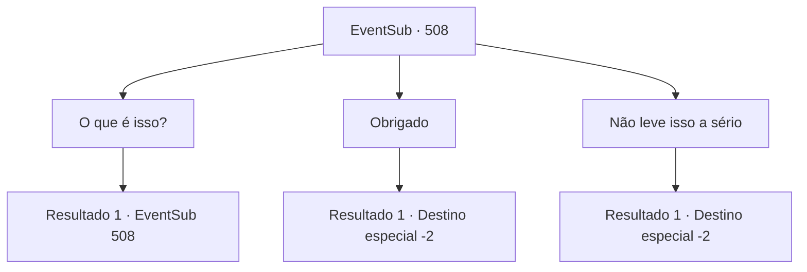

# Eventos secundários · 508

[Índice da tabela](index.md) · [Índice geral](../index.md)

ID: `pt:EventSub:508` · Fonte: `EventSub4` · Versão: 1.2.47.

Mapeamento estático dos arquivos; a disponibilidade e a execução dependem do estado da run.

## Texto do evento

*Sem texto no arquivo.*

## Dados de entrada

```json
{
  "id": 508,
  "grade": 1,
  "subEvent": "",
  "required": ""
}
```

## Mapa das escolhas



## Escolhas e resultados

### Escolha 1

O que é isso?

Requisitos e outros campos da escolha:

```json
{
  "required": "5_460_0"
}
```

#### Resultado 1.1

Ternach parece um pouco orgulhoso ao responder sua pergunta. 

 "Foi Radania? De qualquer forma, pedi um 'favor' para aqueles anões. Queria que eles fizessem uma armadura com minhas escamas."

 Ternach ri alegremente, dizendo que se você usar essa armadura de escamas de dragão, vocês sempre estarão juntos.

Continuação registrada: [Evento 508](0508.md) na mesma tabela.

```json
{
  "required": "",
  "chance": "1",
  "nextEvent": 508,
  "type": 2,
  "reward": "5_460_1"
}
```

### Escolha 2

Obrigado

Requisitos e outros campos da escolha:

```json
{
  "required": ""
}
```

#### Resultado 2.1

Você aceita a armadura que Ternach está oferecendo a você. Ternach te abraça. 

 "Você não pode perdê-la. Pense nela como uma parte de mim."

 Ternach diz que vocês se verão novamente em breve. Você se despede de Ternach.

Continuação registrada: [Destino especial `-2`](../destinos-especiais.md).

```json
{
  "required": "",
  "chance": "1",
  "nextEvent": -2,
  "type": 2,
  "reward": "12_9_5|3_252_1"
}
```

### Escolha 3

Não leve isso a sério

Requisitos e outros campos da escolha:

```json
{
  "required": "5_456_2"
}
```

#### Resultado 3.1

Você rejeita o presente de Ternach. Tenrach responde com uma expressão sombria. 

 "Por quê?... Vocês não gostaram?"

 Você explica a Ternach por que está recusando o presente. Você não pode aceitá-lo porque Ternach intimidou os anões a fazerem a armadura. Os olhos de Ternach se abrem bem. 

 "Oh... Tudo bem então... Nós não somos compatíveis."

 Antes que você possa impedir Ternach, o dragão decola e voa alto no céu.

Continuação registrada: [Destino especial `-2`](../destinos-especiais.md).

```json
{
  "required": "",
  "chance": "1",
  "nextEvent": -2,
  "type": 2,
  "reward": "12_9_-1"
}
```

## Referências que chegam a este evento

- [Evento 507 · escolha 1 · resultado 1](0507.md#escolha-1)
- [Evento 507 · escolha 2 · resultado 1](0507.md#escolha-2)
- [Evento 508 · escolha 1 · resultado 1](0508.md#escolha-1)
