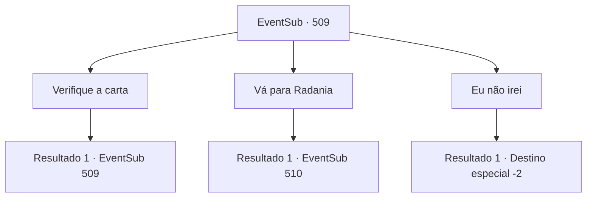

# Eventos secundários · 509

[Índice da tabela](index.md) · [Índice geral](../index.md)

ID: `pt:EventSub:509` · Fonte: `EventSub4` · Versão: 1.2.47.

Mapeamento estático dos arquivos; a disponibilidade e a execução dependem do estado da run.

## Texto do evento

Um anão de meia-idade com uma barba avermelhada se aproxima de você. Ele entrega a você um pedaço de pergaminho. 

 "{1}, certo? Eu estive procurando por você por muito tempo. Sou um mensageiro de Radania. Me chamam de 'Pé-Ligeiro Farnan'. Prazer em conhecê-lo. A mulher mais bonita do mundo está procurando por você."


## Dados de entrada

```json
{
  "id": 509,
  "grade": 1,
  "subEvent": "",
  "required": "12_9_4|1_2_35"
}
```

## Mapa das escolhas



## Escolhas e resultados

### Escolha 1

Verifique a carta

Requisitos e outros campos da escolha:

```json
{
  "required": "5_461_0"
}
```

#### Resultado 1.1

A carta é de Sartha, convidando você a visitar sua terra natal em uma caligrafia caprichada. E na parte inferior do pergaminho, o selo do Senhor de Radania foi carimbado. 

 "Obrigado por salvar nosso orgulho e alegria, Lady Sartha. Agora, por favor, venha para Radania."


Continuação registrada: [Evento 509](0509.md) na mesma tabela.

```json
{
  "required": "",
  "chance": "1",
  "nextEvent": 509,
  "type": 2,
  "reward": "5_461_1"
}
```

### Escolha 2

Vá para Radania

Requisitos e outros campos da escolha:

```json
{
  "required": ""
}
```

#### Resultado 2.1

Você segue o 'Quick-Foot Farnan' até Radania. Radania é uma fortaleza em uma montanha rochosa massiva, governada pelo senhor anão. Paredes cinzentas cercam a área. Um sistema ferroviário saindo das minas atravessa a vila. E no ponto mais alto do assentamento está a mansão do Senhor de Radania. |drawing_Radania| Assim que você entra na fortaleza de Radania, Farnan grita alto. 

 "Todos, abram caminho! Aqui vem o salvador da Lady Sartha!"

 Com o grito de Farnan, todos os anões se viram para olhar para você. 

 "Ok, vamos lá. A Lady está esperando."

 Você caminha pela multidão, seguindo Farnan. Os anões te saúdam enquanto você passa, muitos quase chorando. Eles abaixam a cabeça, alguns se ajoelhando e pressionando a testa no chão. Você passa pela multidão e chega à mansão do senhor. Parado em frente à mansão, você observa a porta de aço se abrir suavemente. 

 "Meu trabalho termina aqui. Entre."

 Farnan para na porta, e os servos de Sartha te cumprimentam.

Continuação registrada: [Evento 510](0510.md) na mesma tabela.

```json
{
  "required": "",
  "chance": "1",
  "nextEvent": 510,
  "type": 2,
  "reward": ""
}
```

### Escolha 3

Eu não irei

Requisitos e outros campos da escolha:

```json
{
  "required": ""
}
```

#### Resultado 3.1

Você responde que não irá para Radania. Farnan parece confuso. 

 "É... é assim? Então não há nada que eu possa fazer. Mas preciso dizer isso antes de nos separarmos."

 Ele pausa por um momento e continua. 

 "Realmente... Muito obrigado. Todos os habitantes de Radania, inclusive eu, somos gratos a você."

 Ele diz que quer lhe oferecer algumas coisas que podem ser úteis. Faran lhe entrega uma poção e algum ouro. E então ele se afasta com passos rápidos.

Continuação registrada: [Destino especial `-2`](../destinos-especiais.md).

```json
{
  "required": "",
  "chance": "1",
  "nextEvent": -2,
  "type": 2,
  "reward": "12_9_-1|14_9_1|3_36_1|3_37_1"
}
```

## Referências que chegam a este evento

- [Evento 509 · escolha 1 · resultado 1](0509.md#escolha-1)
