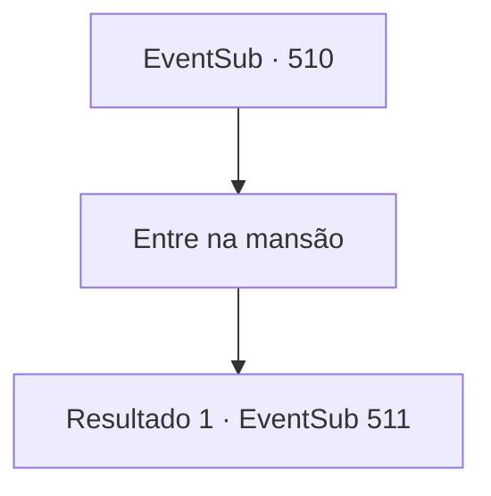

# Eventos secundários · 510

[Índice da tabela](index.md) · [Índice geral](../index.md)

ID: `pt:EventSub:510` · Fonte: `EventSub4` · Versão: 1.2.47.

Mapeamento estático dos arquivos; a disponibilidade e a execução dependem do estado da run.

## Texto do evento

*Sem texto no arquivo.*

## Dados de entrada

```json
{
  "id": 510,
  "grade": 1,
  "subEvent": "",
  "required": ""
}
```

## Mapa das escolhas



## Escolhas e resultados

### Escolha 1

Entre na mansão

Requisitos e outros campos da escolha:

```json
{
  "required": ""
}
```

#### Resultado 1.1

Você entra na mansão construída de cobre e aço. A mansão é decorada com muitas estátuas esculpidas em prata, ouro e outros metais preciosos. Sartha está parada no pé da escadaria central da mansão. Ao lado dela está um homem anão de meia-idade vestindo uma armadura preta decorada com trabalho em ouro. E ao lado dele está uma mulher anã de meia-idade vestindo um vestido de seda chique. Eles se apresentam como pai e mãe de Sartha. 

 "Bem-vindo. Ouvi dizer que você salvou minha filha. Eu sou o Conde 'Radan Tess', Senhor de Radania."

 Ao final da apresentação de seu marido, a mãe de Sartha segura sua mão e fala com lágrimas nos olhos. 

 "Oh... Muito obrigada, de verdade...! Eu preparei uma refeição para você, então coma o quanto quiser."


Continuação registrada: [Evento 511](0511.md) na mesma tabela.

```json
{
  "required": "",
  "chance": "1",
  "nextEvent": 511,
  "type": 2,
  "reward": ""
}
```

## Referências que chegam a este evento

- [Evento 509 · escolha 2 · resultado 1](0509.md#escolha-2)
