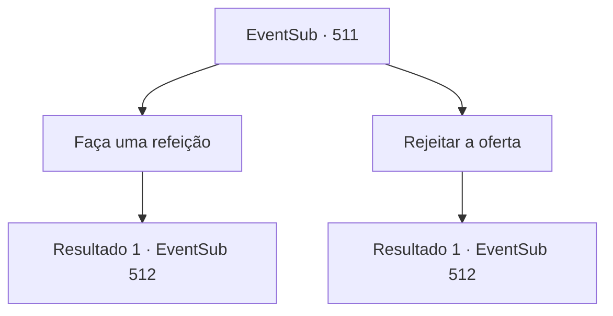

# Eventos secundários · 511

[Índice da tabela](index.md) · [Índice geral](../index.md)

ID: `pt:EventSub:511` · Fonte: `EventSub4` · Versão: 1.2.47.

Mapeamento estático dos arquivos; a disponibilidade e a execução dependem do estado da run.

## Texto do evento

*Sem texto no arquivo.*

## Dados de entrada

```json
{
  "id": 511,
  "grade": 1,
  "subEvent": "",
  "required": ""
}
```

## Mapa das escolhas



## Escolhas e resultados

### Escolha 1

Faça uma refeição

Requisitos e outros campos da escolha:

```json
{
  "required": ""
}
```

#### Resultado 1.1

Você decide fazer como ela diz. Em uma mesa baixa e larga, há todos os tipos de comida. A aparência da comida é um pouco desagradável, mas o cheiro e o sabor são excelentes. 

 Após a refeição, o pai de Sartha, Radan Tess, limpa a boca. Então ele coloca a mão no ombro de Sartha e se dirige a você. 

 "Então, quando você vai se casar com minha filha?"


Continuação registrada: [Evento 512](0512.md) na mesma tabela.

```json
{
  "required": "",
  "chance": "1",
  "nextEvent": 512,
  "type": 2,
  "reward": "0_0_1|0_1_1"
}
```

### Escolha 2

Rejeitar a oferta

Requisitos e outros campos da escolha:

```json
{
  "required": ""
}
```

#### Resultado 2.1

Você rejeita a oferta dela. Então ele coloca a mão no ombro de Sartha e diz. 

 "Então, quando você vai se casar com minha filha?"


Continuação registrada: [Evento 512](0512.md) na mesma tabela.

```json
{
  "required": "",
  "chance": "1",
  "nextEvent": 512,
  "type": 2,
  "reward": ""
}
```

## Referências que chegam a este evento

- [Evento 510 · escolha 1 · resultado 1](0510.md#escolha-1)
