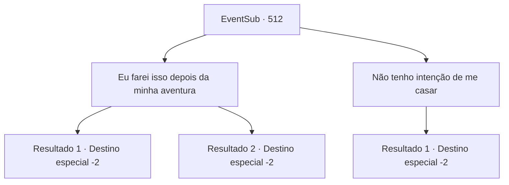

# Eventos secundários · 512

[Índice da tabela](index.md) · [Índice geral](../index.md)

ID: `pt:EventSub:512` · Fonte: `EventSub4` · Versão: 1.2.47.

Mapeamento estático dos arquivos; a disponibilidade e a execução dependem do estado da run.

## Texto do evento

*Sem texto no arquivo.*

## Dados de entrada

```json
{
  "id": 512,
  "grade": 1,
  "subEvent": "",
  "required": ""
}
```

## Mapa das escolhas



## Escolhas e resultados

### Escolha 1

Eu farei isso depois da minha aventura

Requisitos e outros campos da escolha:

```json
{
  "required": "24_1_1"
}
```

#### Resultado 1.1

Você explica que terminará sua aventura atual e depois se casará com Sartha. Sartha cora e sorri timidamente. Tess acena com a cabeça e pede ao mordomo para trazer algo. 

 "Obrigado por salvar minha filha. Há uma recompensa que preparei. Espero que goste."

 Ele estala os dedos. O mordomo retorna e coloca algo na sua frente, embrulhado em pano. 

 "É algo que costumava usar quando era um jovem aventureiro como você. Meu pai fez para mim."

 Quando você desamarra o pano, encontra uma luva enorme. A luva é feita de um metal preto e é tão grande que um gigante poderia usá-la. 

 "Se olhar dentro, há um lugar para você colocar seus dedos. Sim, sim, ali."

 Você coloca a luva na mão e move os dedos. A luva gigante segue seus movimentos. 

 "Volte aqui inteiro. Estaremos nos preparando para o casamento."

 Você se despede da família de Sartha e sai da mansão.

Continuação registrada: [Destino especial `-2`](../destinos-especiais.md).

```json
{
  "required": "18_976_1",
  "chance": "1",
  "nextEvent": -2,
  "type": 2,
  "reward": "12_9_-1|3_253_1|14_9_6|5_462_1"
}
```

#### Resultado 1.2

Você explica que terminará sua aventura atual e depois se casará com Sartha. Sartha cora e sorri timidamente. Tess acena com a cabeça e pede ao mordomo para trazer algo. 

 "Obrigado por salvar minha filha. Há uma recompensa que preparei. Espero que goste."

 Ele estala os dedos. O mordomo retorna e coloca algo na sua frente, embrulhado em pano. 

 "É algo que costumava usar quando era um jovem aventureiro como você. Meu pai fez para mim."

 Quando você desamarra o pano, encontra uma luva enorme. A luva é feita de um metal preto e é tão grande que um gigante poderia usá-la. 

 "Se olhar dentro, há um lugar para você colocar seus dedos. Sim, sim, ali."

 Você coloca a luva na mão e move os dedos. A luva gigante segue seus movimentos. 

 "Volte aqui inteiro. Estaremos nos preparando para o casamento."

 Você se despede da família de Sartha e sai da mansão.

Continuação registrada: [Destino especial `-2`](../destinos-especiais.md).

```json
{
  "required": "5_976_1",
  "chance": "1",
  "nextEvent": -2,
  "type": 2,
  "reward": "12_9_-1|3_253_1|14_9_17|5_462_1"
}
```

### Escolha 2

Não tenho intenção de me casar

Requisitos e outros campos da escolha:

```json
{
  "required": ""
}
```

#### Resultado 2.1

No momento em que você responde, todos - a família de Sartha, os servos e até mesmo Sartha mesma - parecem chocados. Então Tess acena como se ele percebesse algo. 

 "Entendi. Você... Você deve gostar de homens. Eu não tinha pensado nisso."

 Tess se inclina e pede ao mordomo para trazer algo. 

 "Obrigado por salvar minha filha. Há uma recompensa que eu preparei. Espero que você goste."

 Ele estala os dedos. O mordomo retorna e coloca algo na sua frente que está embrulhado em pano. 

 "É algo que eu costumava usar quando era um jovem aventureiro como você. Meu pai fez para mim."

 Quando você desamarra o pano, encontra uma luva enorme. A luva é feita de um metal preto e é tão grande que um gigante poderia usá-la. 

 "Se você olhar dentro, há um lugar para você colocar seus dedos. Sim, sim, ali."

 Você coloca a luva na sua mão e move os dedos. A luva gigante segue seus movimentos. 

 "Por favor, cuide bem dela. E muito obrigado!! Adeus!"

 Você se despede da família de Sartha e sai da mansão.

Continuação registrada: [Destino especial `-2`](../destinos-especiais.md).

```json
{
  "required": "",
  "chance": "1",
  "nextEvent": -2,
  "type": 2,
  "reward": "12_9_-1|14_9_5|3_253_1|0_4_50"
}
```

## Referências que chegam a este evento

- [Evento 511 · escolha 1 · resultado 1](0511.md#escolha-1)
- [Evento 511 · escolha 2 · resultado 1](0511.md#escolha-2)
