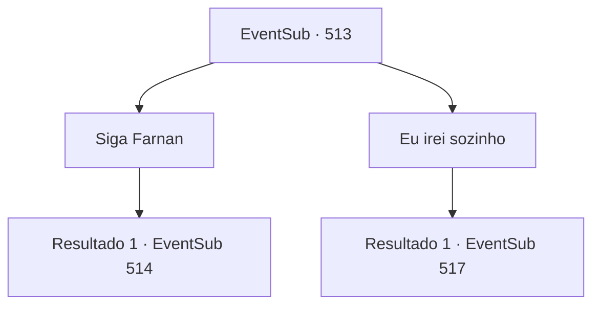

# Eventos secundários · 513

[Índice da tabela](index.md) · [Índice geral](../index.md)

ID: `pt:EventSub:513` · Fonte: `EventSub4` · Versão: 1.2.47.

Mapeamento estático dos arquivos; a disponibilidade e a execução dependem do estado da run.

## Texto do evento

Um anão de meia-idade montado em um camelo se aproxima de você. É 'Pé-Ligeiro Farnan', que você conheceu no início.  Farnan olha para você e entrega a carta de sua bolsa. 

 "O dragão azul me pediu para entregá-la a você."

 A carta diz que Ternach sente sua falta e quer que você venha visitar. Esta carta está escrita de forma bem arrumada, ao contrário da última. Farnan se dirige a você. 

 "O dragão me pediu para levá-lo até sua toca. Venha comigo."

 Ao terminar de falar, ele recomenda que você monte no segundo camelo que ele trouxe.

## Dados de entrada

```json
{
  "id": 513,
  "grade": 1,
  "subEvent": "",
  "required": "12_9_5|1_2_70"
}
```

## Mapa das escolhas



## Escolhas e resultados

### Escolha 1

Siga Farnan

Requisitos e outros campos da escolha:

```json
{
  "required": ""
}
```

#### Resultado 1.1

Você monta no camelo que Farnan trouxe para você e o segue.  Enquanto caminham pelo deserto juntos, você tem a estranha sensação de que alguém está te observando.  Só quando você entra em um desfiladeiro cercado por penhascos de rocha laranja é que você identifica de onde vinha essa sensação. Vários anões aparecem de vários esconderijos no desfiladeiro. 

 "Peão do Dragão! Se você cooperar conosco, pouparemos sua vida."


Continuação registrada: [Evento 514](0514.md) na mesma tabela.

```json
{
  "required": "",
  "chance": "1",
  "nextEvent": 514,
  "type": 2,
  "reward": ""
}
```

### Escolha 2

Eu irei sozinho

Requisitos e outros campos da escolha:

```json
{
  "required": ""
}
```

#### Resultado 2.1

Você segue para o Grande Deserto para encontrar Ternach. Farnan decide te seguir. Ele diz que também quer ver o dragão. 

 "Nós estamos indo para o mesmo caminho de qualquer forma, por que você não monta um camelo comigo? É mais rápido dessa forma. Atravessando o desfiladeiro..."

 Farnan te pergunta várias vezes, mas você ignora seus pedidos e continua andando. Eventualmente, Farnan desiste de falar com você. Após quase meio dia de caminhada, você chega ao covil de Ternach. Lá você encontra Ternach lutando com um grupo de anões. A armadura dos anões está gravada com o emblema de Radania. 

 "Pela Sartha!"

 Enquanto você corre para ajudar Ternach, você sente algo arrepiante atrás de você.

Continuação registrada: [Evento 517](0517.md) na mesma tabela.

```json
{
  "required": "",
  "chance": "1",
  "nextEvent": 517,
  "type": 2,
  "reward": ""
}
```

## Referências que chegam a este evento

Nenhum `nextEvent` positivo da mesma tabela aponta para este nó. Isso não prova que seja inacessível: sorteio e estado de história podem selecioná-lo.

