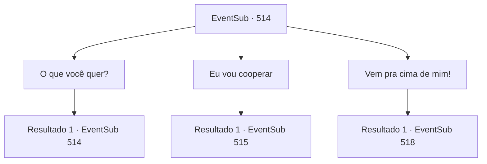

# Eventos secundários · 514

[Índice da tabela](index.md) · [Índice geral](../index.md)

ID: `pt:EventSub:514` · Fonte: `EventSub4` · Versão: 1.2.47.

Mapeamento estático dos arquivos; a disponibilidade e a execução dependem do estado da run.

## Texto do evento

*Sem texto no arquivo.*

## Dados de entrada

```json
{
  "id": 514,
  "grade": 1,
  "subEvent": "",
  "required": ""
}
```

## Mapa das escolhas



## Escolhas e resultados

### Escolha 1

O que você quer?

Requisitos e outros campos da escolha:

```json
{
  "required": "5_463_0"
}
```

#### Resultado 1.1

Farnan responde à sua pergunta. 

 "Eu vou te capturar e depois trazer Sartha de volta"

 Farnan não esconde sua expressão repugnante.

Continuação registrada: [Evento 514](0514.md) na mesma tabela.

```json
{
  "required": "",
  "chance": "1",
  "nextEvent": 514,
  "type": 2,
  "reward": "5_463_1"
}
```

### Escolha 2

Eu vou cooperar

Requisitos e outros campos da escolha:

```json
{
  "required": ""
}
```

#### Resultado 2.1

Você diz que vai cooperar com eles. Os anões te amarram com correntes. Então eles te colocam nas costas do camelo e seguem em direção ao covil de Ternach. 

 Conforme você se aproxima do covil de Ternach, você pode ouvir trovões, pessoas gritando e ferro colidindo com ferro. Então você vê os anões lutando ferozmente com Ternach. Suas armaduras ostentam o emblema de Radania. 

 "Ei! Grande azul! Olhe aqui!!"

 Farnan te puxa das costas do camelo. Você cai na areia quente. 

 "Vamos fazer um acordo! Me dê a senhora Sartha! Em troca, você pode ter esse aventureiro!"

 Quando Ternach te vê amarrado, eles parecem surpresos. Farnan se inclina e fala baixinho com você. 

 "Vamos lá. Grite por ajuda."


Continuação registrada: [Evento 515](0515.md) na mesma tabela.

```json
{
  "required": "",
  "chance": "1",
  "nextEvent": 515,
  "type": 2,
  "reward": ""
}
```

### Escolha 3

Vem pra cima de mim!

Requisitos e outros campos da escolha:

```json
{
  "required": ""
}
```

#### Resultado 3.1

Você grita com Farnan e os outros anões.  Portando o emblema de Radania em suas armaduras, eles correm em sua direção com espadas, escudos, machados e martelos.  

 "Pela Sartha!"


Continuação registrada: [Evento 518](0518.md) na mesma tabela.

```json
{
  "required": "",
  "chance": "1",
  "nextEvent": 518,
  "type": 2,
  "reward": "6_0_158",
  "place": 5
}
```

## Referências que chegam a este evento

- [Evento 513 · escolha 1 · resultado 1](0513.md#escolha-1)
- [Evento 514 · escolha 1 · resultado 1](0514.md#escolha-1)
