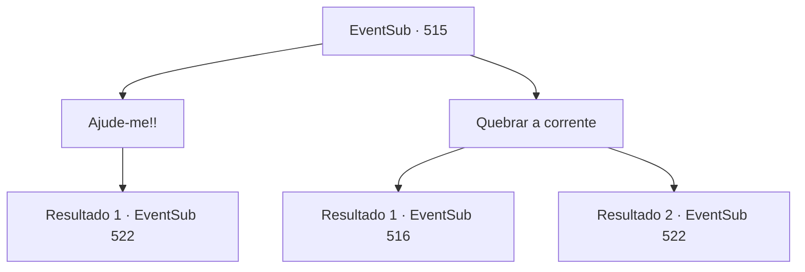

# Eventos secundários · 515

[Índice da tabela](index.md) · [Índice geral](../index.md)

ID: `pt:EventSub:515` · Fonte: `EventSub4` · Versão: 1.2.47.

Mapeamento estático dos arquivos; a disponibilidade e a execução dependem do estado da run.

## Texto do evento

*Sem texto no arquivo.*

## Dados de entrada

```json
{
  "id": 515,
  "grade": 1,
  "subEvent": "",
  "required": ""
}
```

## Mapa das escolhas



## Escolhas e resultados

### Escolha 1

Ajude-me!!

Requisitos e outros campos da escolha:

```json
{
  "required": ""
}
```

#### Resultado 1.1

Você implora a Ternach por ajuda com uma voz lamentosa. Ternach rosna. 

 "Crrrr... Malditos anões!"

 Ternach volta para a toca e retorna com Sartha. Enquanto Sartha sai, os anões começam a chorar emocionados. Farnan te desamarra, te levanta e te empurra em direção a Ternach. Sartha começa a caminhar em direção aos anões. Vocês se cruzam no meio dos dois lados. 

 "Se apressem e saiam daqui!"

 Ternach grita com raiva, e os anões se retiram com Sartha. Enquanto eles desaparecem sobre as dunas de areia, Ternach olha para você. 

 "Vocês estão bem? Vocês se machucaram?"


Continuação registrada: [Evento 522](0522.md) na mesma tabela.

```json
{
  "required": "",
  "chance": "1",
  "nextEvent": 522,
  "type": 2,
  "reward": ""
}
```

### Escolha 2

Quebrar a corrente

Requisitos e outros campos da escolha:

```json
{
  "required": ""
}
```

#### Resultado 2.1

Você quebra as correntes que te prendem com uma força incrível. Os anões ao seu redor percebem e apontam suas armas para você. Farnan exclama perplexo. 

 "O que...! Droga...!!"


Continuação registrada: [Evento 516](0516.md) na mesma tabela.

```json
{
  "required": "",
  "chance": "1|0_5_1",
  "nextEvent": 516,
  "type": 0,
  "reward": ""
}
```

#### Resultado 2.2

Você luta com todas as suas forças, mas não consegue quebrar as correntes. Ternach rosna. 

 "Crrrr... Malditos anões!"

 Ternach volta para a toca e retorna com Sartha. Enquanto Sartha sai, os anões começam a chorar emocionados. Farnan te desamarra, te levanta e te empurra em direção a Ternach. Sartha começa a caminhar em direção aos anões. Vocês se cruzam no meio dos dois lados. 

 "Se apressem e saiam daqui!"

 Ternach grita com raiva, e os anões se retiram com Sartha. Enquanto eles desaparecem sobre as dunas de areia, Ternach olha para você. 

 "Vocês estão bem? Vocês se machucaram?"


Continuação registrada: [Evento 522](0522.md) na mesma tabela.

```json
{
  "required": "",
  "chance": "20",
  "nextEvent": 522,
  "type": 1,
  "reward": ""
}
```

## Referências que chegam a este evento

- [Evento 514 · escolha 2 · resultado 1](0514.md#escolha-2)
