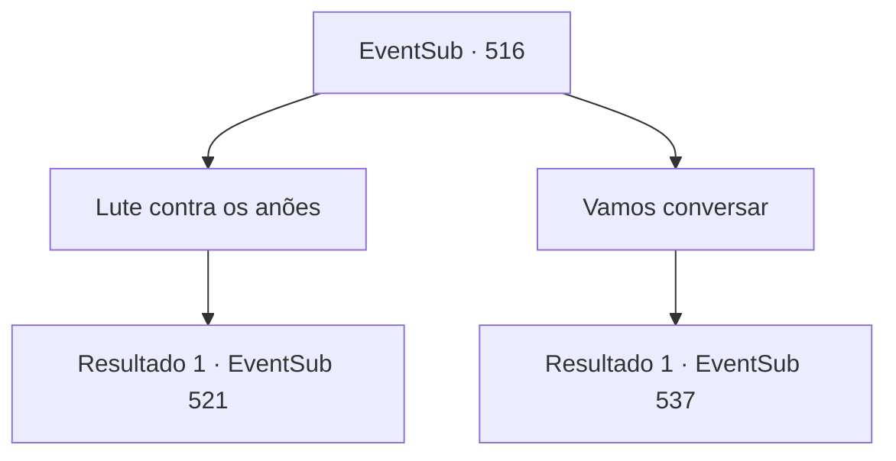

# Eventos secundários · 516

[Índice da tabela](index.md) · [Índice geral](../index.md)

ID: `pt:EventSub:516` · Fonte: `EventSub4` · Versão: 1.2.47.

Mapeamento estático dos arquivos; a disponibilidade e a execução dependem do estado da run.

## Texto do evento

*Sem texto no arquivo.*

## Dados de entrada

```json
{
  "id": 516,
  "grade": 1,
  "subEvent": "",
  "required": ""
}
```

## Mapa das escolhas



## Escolhas e resultados

### Escolha 1

Lute contra os anões

Requisitos e outros campos da escolha:

```json
{
  "required": ""
}
```

#### Resultado 1.1

Você avança em direção aos anões de Radania. Com um estouro de relâmpago, Ternach pula ao seu lado. 

 "Vem aqui, seus pestinhas!"

 Assim, a luta recomeça e sangue cai na areia.

Continuação registrada: [Evento 521](0521.md) na mesma tabela.

```json
{
  "required": "",
  "chance": "1",
  "nextEvent": 521,
  "type": 2,
  "reward": "6_0_159",
  "place": 5
}
```

### Escolha 2

Vamos conversar

Requisitos e outros campos da escolha:

```json
{
  "required": ""
}
```

#### Resultado 2.1

Você levanta as mãos e diz aos anões armados que não quer lutar. Talvez isso possa ser resolvido conversando sobre o problema. Ternach resmunga e responde. 

 "Eu não tenho nada a dizer para esses caras."

 Farnan também responde com os braços cruzados. 

 "Se esse fosse um problema que pudesse ser resolvido através do diálogo, já teria sido resolvido."


Continuação registrada: [Evento 537](0537.md) na mesma tabela.

```json
{
  "required": "",
  "chance": "1",
  "nextEvent": 537,
  "type": 2,
  "reward": ""
}
```

## Referências que chegam a este evento

- [Evento 515 · escolha 2 · resultado 1](0515.md#escolha-2)
