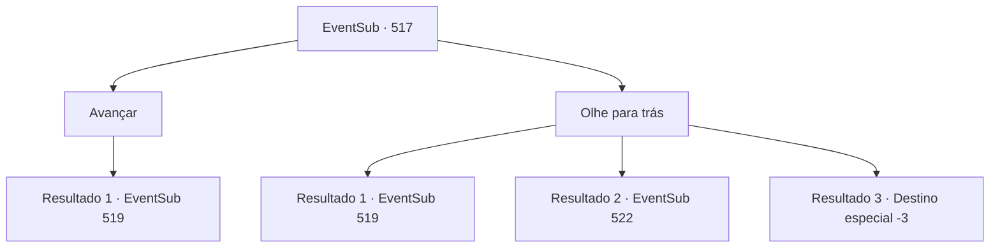

# Eventos secundários · 517

[Índice da tabela](index.md) · [Índice geral](../index.md)

ID: `pt:EventSub:517` · Fonte: `EventSub4` · Versão: 1.2.47.

Mapeamento estático dos arquivos; a disponibilidade e a execução dependem do estado da run.

## Texto do evento

*Sem texto no arquivo.*

## Dados de entrada

```json
{
  "id": 517,
  "grade": 1,
  "subEvent": "",
  "required": ""
}
```

## Mapa das escolhas



## Escolhas e resultados

### Escolha 1

Avançar

Requisitos e outros campos da escolha:

```json
{
  "required": "1_14_10"
}
```

#### Resultado 1.1

Você tem a sensação de que alguém está vindo por trás de você. Sem olhar para trás, você se joga para frente. Você ouve o som de um martelo cortando o ar. 

 "Merda... Você também tem olhos na parte de trás da cabeça?"

 Farnan se equilibra, empunhando seu martelo, e então corre em sua direção.

Continuação registrada: [Evento 519](0519.md) na mesma tabela.

```json
{
  "required": "",
  "chance": "1",
  "nextEvent": 519,
  "type": 2,
  "reward": "6_0_158",
  "place": 5
}
```

### Escolha 2

Olhe para trás

Requisitos e outros campos da escolha:

```json
{
  "required": ""
}
```

#### Resultado 2.1

Você olha para trás. E encontra Farnan segurando um martelo e mirando em sua cabeça. Você rola para o lado e evita o martelo de Farnan. 

 "Hmph..."

 Farnan se estabiliza, empunhando seu martelo, e então corre em sua direção.

Continuação registrada: [Evento 519](0519.md) na mesma tabela.

```json
{
  "required": "1_0_2",
  "chance": "1|0_6_1",
  "nextEvent": 519,
  "type": 0,
  "reward": "6_0_158",
  "place": 5
}
```

#### Resultado 2.2

Você olha para trás. E encontra Farnan segurando um martelo e mirando em sua cabeça. <link=shake>'Bang-!'</link> À medida que sua visão falha, seu corpo se levanta por um tempo e depois cai no chão. Farnan se aproxima de você, que caiu, e te amarra com uma corrente. Você não consegue mover seu corpo em um grande choque. Quando você está inconsciente por um tempo e então abre os olhos novamente, eles estão oferecendo Ternach em troca de você e Sartha. Ternach ronrona e diz. 

 "Crrrr... Malditos anões!"

 Então Ternach volta para a toca e traz Sartha. Enquanto Sartha sai, os anões começam a chorar emocionados. Após a troca, você fica relaxado e inconsciente novamente. Você perde a consciência por um momento. Quando você retorna, deita-se olhando para o teto da caverna. 

 "Vocês estão bem? Vocês se machucaram?"

 Ternach olha para baixo para você e diz.

Continuação registrada: [Evento 522](0522.md) na mesma tabela.

```json
{
  "required": "1_0_2",
  "chance": "14",
  "nextEvent": 522,
  "type": 1,
  "reward": "0_0_-1"
}
```

#### Resultado 2.3

Você olha para trás. E encontra Farnan segurando um martelo e mirando em sua cabeça.
 <link=shake>'Bang-!'</link>
 Enquanto sua visão falha, sua alma parece flutuar para fora do seu corpo antes de cair de volta ao chão. Farnan se inclina sobre sua figura caída e te amarra com correntes. Seus olhos se fecham.

Continuação registrada: [Destino especial `-3`](../destinos-especiais.md).

```json
{
  "required": "2_0_2",
  "chance": "1",
  "nextEvent": -3,
  "type": 2,
  "reward": "0_0_-1"
}
```

## Referências que chegam a este evento

- [Evento 513 · escolha 2 · resultado 1](0513.md#escolha-2)
