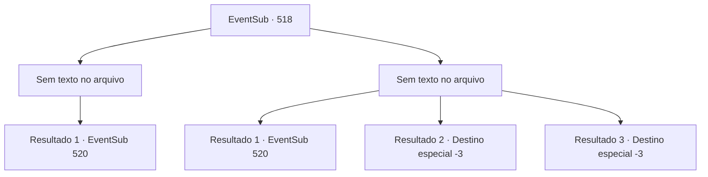

# Eventos secundários · 518

[Índice da tabela](index.md) · [Índice geral](../index.md)

ID: `pt:EventSub:518` · Fonte: `EventSub4` · Versão: 1.2.47.

Mapeamento estático dos arquivos; a disponibilidade e a execução dependem do estado da run.

## Texto do evento

*Sem texto no arquivo.*

## Dados de entrada

```json
{
  "id": 518,
  "grade": 1,
  "subEvent": "",
  "required": ""
}
```

## Mapa das escolhas



## Escolhas e resultados

### Escolha 1

*Sem texto no arquivo; o papel dessa opção depende da interface do jogo.*

Requisitos e outros campos da escolha:

```json
{
  "required": ""
}
```

#### Resultado 1.1

O vento do canyon lava o cheiro de sangue. 

 "Ofegante... senhora... Sartha..."

 Você o escuta por um momento antes de seguir direto para o covil de Ternach. 

 Conforme você se aproxima do covil de Ternach, você pode ouvir trovões, pessoas gritando e ferro colidindo com ferro. Então você vê anões lutando ferozmente com Ternach. Suas armaduras ostentam o emblema de Radania.

Continuação registrada: [Evento 520](0520.md) na mesma tabela.

```json
{
  "required": "",
  "chance": "1",
  "nextEvent": 520,
  "type": 2,
  "reward": ""
}
```

### Escolha 2

*Sem texto no arquivo; o papel dessa opção depende da interface do jogo.*

Requisitos e outros campos da escolha:

```json
{
  "required": ""
}
```

#### Resultado 2.1

Você sai do desfiladeiro e foge dos anões. Eles estão usando armaduras pesadas e têm pernas curtas, então não conseguirão te seguir por muito tempo. 

 Depois de correr por um tempo, você segue em direção ao covil de Ternach. Mas também não é um lugar seguro. Conforme você se aproxima do covil de Ternach, você pode ouvir trovões, pessoas gritando e ferro colidindo com ferro. Então você vê anões lutando ferozmente com Ternach. Suas armaduras têm o emblema de Radania.

Continuação registrada: [Evento 520](0520.md) na mesma tabela.

```json
{
  "required": "1_0_2|1_1_2",
  "chance": "1",
  "nextEvent": 520,
  "type": 2,
  "reward": "0_0_-1|0_1_-1"
}
```

#### Resultado 2.2

<link=shake>'Bang-!'</link>
 À medida que sua visão falha, sua alma parece flutuar para fora do seu corpo antes de cair de volta ao chão. Farnan se inclina sobre sua figura caída e te amarra com correntes. Seus olhos se fecham.

Continuação registrada: [Destino especial `-3`](../destinos-especiais.md).

```json
{
  "required": "2_0_2",
  "chance": "1",
  "nextEvent": -3,
  "type": 2,
  "reward": "0_0_-1|0_1_-1"
}
```

#### Resultado 2.3

<link=shake>'Bang-!'</link>
 À medida que sua visão falha, sua alma parece flutuar para fora do seu corpo antes de cair de volta ao chão. Farnan se inclina sobre sua figura caída e te amarra com correntes. Seus olhos se fecham.

Continuação registrada: [Destino especial `-3`](../destinos-especiais.md).

```json
{
  "required": "2_1_2",
  "chance": "1",
  "nextEvent": -3,
  "type": 2,
  "reward": "0_0_-1|0_1_-1"
}
```

## Referências que chegam a este evento

- [Evento 514 · escolha 3 · resultado 1](0514.md#escolha-3)
