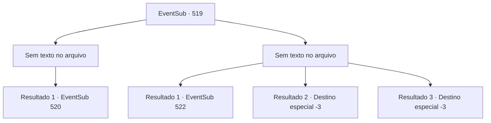

# Eventos secundários · 519

[Índice da tabela](index.md) · [Índice geral](../index.md)

ID: `pt:EventSub:519` · Fonte: `EventSub4` · Versão: 1.2.47.

Mapeamento estático dos arquivos; a disponibilidade e a execução dependem do estado da run.

## Texto do evento

*Sem texto no arquivo.*

## Dados de entrada

```json
{
  "id": 519,
  "grade": 1,
  "subEvent": "",
  "required": ""
}
```

## Mapa das escolhas



## Escolhas e resultados

### Escolha 1

*Sem texto no arquivo; o papel dessa opção depende da interface do jogo.*

Requisitos e outros campos da escolha:

```json
{
  "required": ""
}
```

#### Resultado 1.1

Você derruba Farnan e segue direto para Ternach. Ternach está bloqueando os anões de entrarem no covil. Os invasores usam armaduras com o emblema de Radania. 

 "Oh meu Deus! Eles já estão aqui!"

 "Como vocês sabiam que eu estava sendo atacado?"

 Ternach e os anões param surpresos quando percebem você. Aproveitando a pausa momentânea na luta, você se coloca entre eles.

Continuação registrada: [Evento 520](0520.md) na mesma tabela.

```json
{
  "required": "",
  "chance": "1",
  "nextEvent": 520,
  "type": 2,
  "reward": ""
}
```

### Escolha 2

*Sem texto no arquivo; o papel dessa opção depende da interface do jogo.*

Requisitos e outros campos da escolha:

```json
{
  "required": ""
}
```

#### Resultado 2.1

<link=shake>'Bang-!'</link>
 À medida que sua visão falha, sua alma parece flutuar para fora do seu corpo antes de cair de volta ao chão. Farnan se inclina sobre sua figura caída e te amarra com correntes. Você não consegue reagir, pois ainda está atordoado pelo golpe. Os anões se voltam para Ternach e oferecem libertá-lo em troca de Sartha. Ternach rosna. 

 "Crrrr... Malditos anões!"

 Ternach volta para a toca e retorna com Sartha. Enquanto Sartha sai, os anões começam a chorar emocionados. Após a troca, seu corpo relaxa e você desmaia. Quando você acorda, está deitado de costas, olhando para o teto da caverna. 

 "Vocês estão bem? Vocês se machucaram?"

 Ternach olha para baixo para você.

Continuação registrada: [Evento 522](0522.md) na mesma tabela.

```json
{
  "required": "1_0_2|1_1_2",
  "chance": "1",
  "nextEvent": 522,
  "type": 2,
  "reward": "0_0_-1|0_1_-1"
}
```

#### Resultado 2.2

<link=shake>'Bang-!'</link>
 À medida que sua visão falha, sua alma parece flutuar para fora do seu corpo antes de cair de volta ao chão. Farnan se inclina sobre sua figura caída e te amarra com correntes. Seus olhos se fecham.

Continuação registrada: [Destino especial `-3`](../destinos-especiais.md).

```json
{
  "required": "2_0_2",
  "chance": "1",
  "nextEvent": -3,
  "type": 2,
  "reward": "0_0_-1|0_1_-1"
}
```

#### Resultado 2.3

<link=shake>'Bang-!'</link>
 À medida que sua visão falha, sua alma parece flutuar para fora do seu corpo antes de cair de volta ao chão. Farnan se inclina sobre sua figura caída e te amarra com correntes. Seus olhos se fecham.

Continuação registrada: [Destino especial `-3`](../destinos-especiais.md).

```json
{
  "required": "2_1_2",
  "chance": "1",
  "nextEvent": -3,
  "type": 2,
  "reward": "0_0_-1|0_1_-1"
}
```

## Referências que chegam a este evento

- [Evento 517 · escolha 1 · resultado 1](0517.md#escolha-1)
- [Evento 517 · escolha 2 · resultado 1](0517.md#escolha-2)
