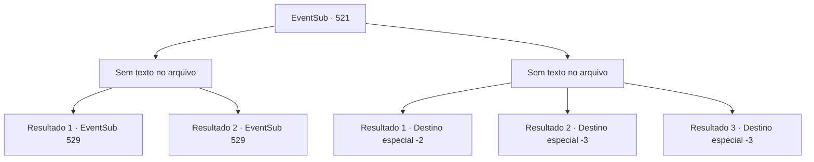

# Eventos secundários · 521

[Índice da tabela](index.md) · [Índice geral](../index.md)

ID: `pt:EventSub:521` · Fonte: `EventSub4` · Versão: 1.2.47.

Mapeamento estático dos arquivos; a disponibilidade e a execução dependem do estado da run.

## Texto do evento

*Sem texto no arquivo.*

## Dados de entrada

```json
{
  "id": 521,
  "grade": 1,
  "subEvent": "",
  "required": ""
}
```

## Mapa das escolhas



## Escolhas e resultados

### Escolha 1

*Sem texto no arquivo; o papel dessa opção depende da interface do jogo.*

Requisitos e outros campos da escolha:

```json
{
  "required": ""
}
```

#### Resultado 1.1

Você e Ternach derrotam os anões de Radania.  Aqueles que não foram reduzidos a cinzas estão fugindo, gravemente feridos.  Ternach grita triunfantemente.  

 "Khahaha-! Vão embora logo! Seus pirralhos!"

  Apesar de sua atitude arrogante, o corpo de Ternach está coberto de feridas.  Os dois de vocês seguem para a toca dela. Ao contrário antes, há objetos humanos e móveis espalhados pela caverna. 

 "Quero mostrar a vocês este lugar agora que terminei de decorar... Ai, ai."

  Ternach se transforma em uma figura humana e cai na cama gemendo.  Ela olha para você.  

 "Mano... Por favor, me ajude a enfaixar meus ferimentos."


Continuação registrada: [Evento 529](0529.md) na mesma tabela.

```json
{
  "required": "11_0_0",
  "chance": "1",
  "nextEvent": 529,
  "type": 2,
  "reward": ""
}
```

#### Resultado 1.2

Você e Ternach derrotam os anões de Radania.  Aqueles que não foram reduzidos a cinzas estão fugindo, gravemente feridos.  Ternach grita triunfantemente.  

 "Khahaha-! Vão embora logo! Seus pirralhos!"

  Apesar de sua atitude arrogante, o corpo de Ternach está coberto de feridas.  Os dois de vocês entram em sua toca. Ao contrário antes, há objetos humanos e móveis por toda a caverna. 

 "Quero mostrar a vocês este lugar agora que terminei de decorar... Ai, ai."

  Ternach se transforma em uma figura humana e cai na cama gemendo.  Ele olha para você.  

 "Irmã... Por favor, me ajude a enfaixar meus ferimentos."


Continuação registrada: [Evento 529](0529.md) na mesma tabela.

```json
{
  "required": "11_0_1",
  "chance": "1",
  "nextEvent": 529,
  "type": 2,
  "reward": ""
}
```

### Escolha 2

*Sem texto no arquivo; o papel dessa opção depende da interface do jogo.*

Requisitos e outros campos da escolha:

```json
{
  "required": ""
}
```

#### Resultado 2.1

Você cai no chão quando o martelo de um anão bate em você. Sangue quente escorre da sua testa. Você ouve Ternach gritando. 

 "Vou distraí-los, então corra e fuja!"

 Então Ternach corre em direção aos anões, vomitando trovões. Você consegue se levantar, mas assim que fica de pé sua visão escurece. 

 Sem saber quanto tempo se passou, você levanta a cabeça para fora da areia. Parece que o sol se pôs sobre o deserto. Mas não é noite. É a asa de Ternach cobrindo você, bloqueando o sol. Você rasteja para fora de baixo das asas de Ternach e olha para o rosto do dragão. Os olhos de Ternach estão abertos, mas não há movimento. Não há respiração. E o chifre, a característica marcante de um dragão azul, foi cortado. Você fecha os olhos de Ternach e vai embora.

Continuação registrada: [Destino especial `-2`](../destinos-especiais.md).

```json
{
  "required": "1_0_2|1_1_2",
  "chance": "1",
  "nextEvent": -2,
  "type": 2,
  "reward": "0_0_-1|0_1_-1|12_9_-1|14_9_3|14_9_14"
}
```

#### Resultado 2.2

Você cai no chão quando o martelo de um anão te acerta. Sangue quente escorre da sua testa. Você ouve Ternach gritando. 

 "Vou distraí-los, então corra e fuja!"

 Então Ternach avança contra os anões, lançando trovões. Você consegue se levantar, mas assim que fica de pé sua visão escurece.

Continuação registrada: [Destino especial `-3`](../destinos-especiais.md).

```json
{
  "required": "2_0_2",
  "chance": "1",
  "nextEvent": -3,
  "type": 2,
  "reward": "0_0_-1|0_1_-1"
}
```

#### Resultado 2.3

Você cai no chão quando o martelo de um anão te acerta. Sangue quente escorre da sua testa. Você ouve Ternach gritando. 

 "Vou distraí-los, então corra e fuja!"

 Então Ternach avança contra os anões, lançando trovões. Você consegue se levantar, mas assim que fica de pé sua visão escurece.

Continuação registrada: [Destino especial `-3`](../destinos-especiais.md).

```json
{
  "required": "2_1_2",
  "chance": "1",
  "nextEvent": -3,
  "type": 2,
  "reward": "0_0_-1|0_1_-1"
}
```

## Referências que chegam a este evento

- [Evento 516 · escolha 1 · resultado 1](0516.md#escolha-1)
- [Evento 520 · escolha 1 · resultado 1](0520.md#escolha-1)
- [Evento 537 · escolha 1 · resultado 2](0537.md#escolha-1)
- [Evento 537 · escolha 3 · resultado 1](0537.md#escolha-3)
