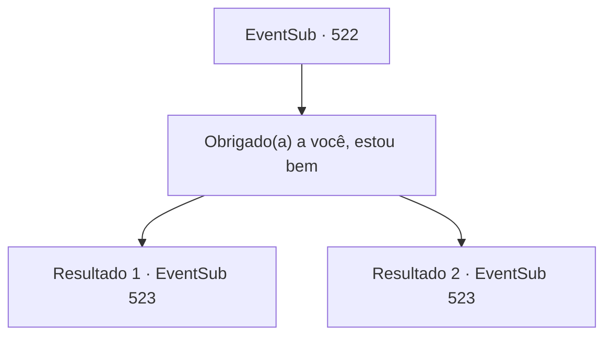

# Eventos secundários · 522

[Índice da tabela](index.md) · [Índice geral](../index.md)

ID: `pt:EventSub:522` · Fonte: `EventSub4` · Versão: 1.2.47.

Mapeamento estático dos arquivos; a disponibilidade e a execução dependem do estado da run.

## Texto do evento

*Sem texto no arquivo.*

## Dados de entrada

```json
{
  "id": 522,
  "grade": 1,
  "subEvent": "",
  "required": ""
}
```

## Mapa das escolhas



## Escolhas e resultados

### Escolha 1

Obrigado(a) a você, estou bem

Requisitos e outros campos da escolha:

```json
{
  "required": ""
}
```

#### Resultado 1.1

Ternach te apoia e te ajuda a entrar na caverna. Ao contrário antes, há objetos humanos e móveis por toda a caverna. 

 "Quero mostrar a vocês este lugar agora que terminei de decorar... Deite-se aqui por um momento."

 Ternach se transforma em sua forma humana. Ela te ajuda a deitar na cama e vai buscar bandagens e remédios. Quando ela retorna, começa a aplicar o remédio. Você não sabe se o corpo humano é desconhecido para ela, ou se ela apenas tem uma maneira especial de fazer as coisas, mas quando ela termina, seu corpo está quase completamente encharcado de remédio. Ao te ver assim, Ternach engole sua saliva. 

 "Não... ele está machucado agora, então tenho que segurar isso."

 Ela murmura para si mesma e deita ao seu lado. Suas pálpebras ficam pesadas e você adormece. 

 Seu sono é agitado, e você pode ouvir um som ecoando na caverna.

 'Bum... Bum...!!'

Continuação registrada: [Evento 523](0523.md) na mesma tabela.

```json
{
  "required": "11_0_0",
  "chance": "1",
  "nextEvent": 523,
  "type": 2,
  "reward": "0_0_1|0_1_1"
}
```

#### Resultado 1.2

Ternach te apoia e te ajuda a entrar na caverna. Ao contrário antes, há objetos humanos e móveis por toda a caverna. 

 "Quero mostrar a vocês este lugar agora que terminei de decorar... Deite-se aqui por um momento."

 Ternach se transforma em sua forma humana. Ele te ajuda a deitar na cama e vai buscar bandagens e remédios. Quando ele retorna, começa a aplicar o remédio. Você não sabe se o corpo humano é desconhecido para ele, ou se ele apenas tem uma maneira especial de fazer as coisas, mas quando ele termina, seu corpo está quase completamente encharcado de remédio. Ao te ver assim, Ternach engole sua saliva. 

 "Não... ela está machucada agora, então tenho que segurar isso."

 Ele murmura para si mesmo e deita ao seu lado. Suas pálpebras ficam pesadas e você adormece. 

 Seu sono é agitado, e você pode ouvir um som ecoando na caverna.

 'Bum... Bum...!!'

Continuação registrada: [Evento 523](0523.md) na mesma tabela.

```json
{
  "required": "11_0_1",
  "chance": "1",
  "nextEvent": 523,
  "type": 2,
  "reward": "0_0_1|0_1_1"
}
```

## Referências que chegam a este evento

- [Evento 515 · escolha 1 · resultado 1](0515.md#escolha-1)
- [Evento 515 · escolha 2 · resultado 2](0515.md#escolha-2)
- [Evento 517 · escolha 2 · resultado 2](0517.md#escolha-2)
- [Evento 519 · escolha 2 · resultado 1](0519.md#escolha-2)
