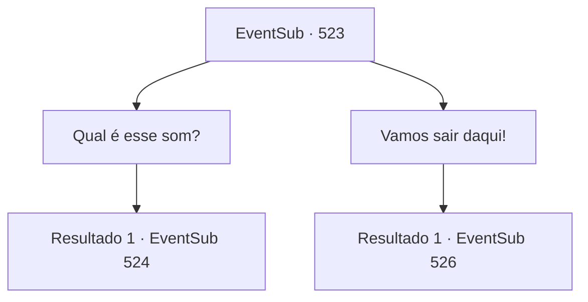

# Eventos secundários · 523

[Índice da tabela](index.md) · [Índice geral](../index.md)

ID: `pt:EventSub:523` · Fonte: `EventSub4` · Versão: 1.2.47.

Mapeamento estático dos arquivos; a disponibilidade e a execução dependem do estado da run.

## Texto do evento

*Sem texto no arquivo.*

## Dados de entrada

```json
{
  "id": 523,
  "grade": 1,
  "subEvent": "",
  "required": ""
}
```

## Mapa das escolhas



## Escolhas e resultados

### Escolha 1

Qual é esse som?

Requisitos e outros campos da escolha:

```json
{
  "required": ""
}
```

#### Resultado 1.1

Você olha para cima no teto de onde você acha que o som está vindo. A caverna treme, e areia solta cai. E logo depois, o teto desaba, e terra desce.

Continuação registrada: [Evento 524](0524.md) na mesma tabela.

```json
{
  "required": "",
  "chance": "1",
  "nextEvent": 524,
  "type": 2,
  "reward": ""
}
```

### Escolha 2

Vamos sair daqui!

Requisitos e outros campos da escolha:

```json
{
  "required": "1_14_10"
}
```

#### Resultado 2.1

Você acorda Ternach imediatamente. Ternach, que estava babando, rapidamente limpa as evidências. 

 "O que está acontecendo?"

 Ternach percebe que alguém está atacando o covil e rapidamente se transforma em um dragão. 

 "Como ousam...! Ah, esses anões?! Vamos lá! Estou realmente ansioso para destruí-los desta vez!"

 Você e Ternach saem correndo da caverna. E lá você encontra os anões de Radania novamente. |drawing_Urrvan| Eles aparecem com uma grande estrutura que você nunca viu antes. É um cilindro enorme feito de bronze. Você olha para o deserto e vê cerca de 10 cilindros enormes, cada um com quase 8 metros de comprimento. Ao lado desses cilindros estão várias balistas. 

 "Vocês são os inimigos de Radania! Estamos aqui para nos livrar de vocês de uma vez por todas. Não vou deixar vocês nos intimidarem novamente!"

 Ternach rosna de volta, impassível. 

 "Façam o que quiserem! Seus idiotas insignificantes!"

 Enquanto Ternach espalha suas asas, uma das balistas dispara um enorme arpão com uma corrente presa. As correntes envolvem o corpo de Ternach e impedem o dragão de decolar. 

 "Todos, disparem seus canhões!"

 Com esse grito, os anões acendem os canhões de bronze.

Continuação registrada: [Evento 526](0526.md) na mesma tabela.

```json
{
  "required": "",
  "chance": "1",
  "nextEvent": 526,
  "type": 2,
  "reward": ""
}
```

## Referências que chegam a este evento

- [Evento 522 · escolha 1 · resultado 1](0522.md#escolha-1)
- [Evento 522 · escolha 1 · resultado 2](0522.md#escolha-1)
