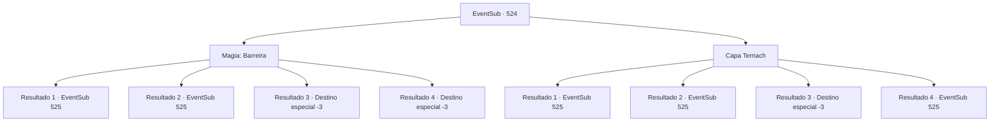

# Eventos secundários · 524

[Índice da tabela](index.md) · [Índice geral](../index.md)

ID: `pt:EventSub:524` · Fonte: `EventSub4` · Versão: 1.2.47.

Mapeamento estático dos arquivos; a disponibilidade e a execução dependem do estado da run.

## Texto do evento

*Sem texto no arquivo.*

## Dados de entrada

```json
{
  "id": 524,
  "grade": 1,
  "subEvent": "",
  "required": ""
}
```

## Mapa das escolhas



## Escolhas e resultados

### Escolha 1

Magia: Barreira

Requisitos e outros campos da escolha:

```json
{
  "required": "1_1_2|20_0_1"
}
```

#### Resultado 1.1

Você rapidamente cria uma barreira mágica para impedir que a areia e as pedras entrem. Ternach, que estava babando, rapidamente limpa as evidências. 

 "O que está acontecendo?"

 Ternach percebe que alguém está atacando o covil e rapidamente se transforma em um dragão. 

 "Como eles se atrevem...! Ah, esses anões?! Vamos lá! Estou realmente determinado a destruí-los desta vez!"


Continuação registrada: [Evento 525](0525.md) na mesma tabela.

```json
{
  "required": "",
  "chance": "1|0_14_1",
  "nextEvent": 525,
  "type": 0,
  "reward": "0_1_-1"
}
```

#### Resultado 1.2

Você tenta criar uma barreira, mas seu feitiço falha. Areia e pedras caem em cima de você e Ternach. 

 "Ahk...! O que é isso?!"

 Ternach percebe que alguém está atacando o covil e rapidamente se transforma em um dragão. 

 "Como eles se atrevem...! Oh, aqueles anões?! Vamos lá! Estou realmente determinado a destruí-los desta vez!"


Continuação registrada: [Evento 525](0525.md) na mesma tabela.

```json
{
  "required": "1_0_2|1_1_2",
  "chance": "14",
  "nextEvent": 525,
  "type": 1,
  "reward": "0_0_-1|0_1_-1"
}
```

#### Resultado 1.3

Você tenta criar uma barreira, mas seu feitiço falha. Areia e pedras caem em cima de você e Ternach. Você é esmagado por uma pedra que cai e sua mente fica em branco.

Continuação registrada: [Destino especial `-3`](../destinos-especiais.md).

```json
{
  "required": "2_0_2",
  "chance": "14",
  "nextEvent": -3,
  "type": 1,
  "reward": "0_0_-1|0_1_-1"
}
```

#### Resultado 1.4

Você tenta criar uma barreira, mas seu feitiço falha. Areia e pedras caem em cima de você e Ternach. Você é esmagado por uma pedra que cai e sua mente fica em branco.

Continuação registrada: [Destino especial `-3`](../destinos-especiais.md).

```json
{
  "required": "2_1_2",
  "chance": "14",
  "nextEvent": -3,
  "type": 1,
  "reward": "0_0_-1|0_1_-1"
}
```

### Escolha 2

Capa Ternach

Requisitos e outros campos da escolha:

```json
{
  "required": ""
}
```

#### Resultado 2.1

Você se move para proteger Ternach, bloqueando a areia e as pedras que estão caindo. Ternach, que estava babando, rapidamente limpa as evidências. 

 "O que está acontecendo?"

 Ternach percebe que alguém está atacando o covil e rapidamente se transforma em um dragão. 

 "Como eles se atrevem...! Oh, aqueles anões?! Vamos lá! Estou realmente determinado a destruí-los desta vez!"


Continuação registrada: [Evento 525](0525.md) na mesma tabela.

```json
{
  "required": "21_9_2",
  "chance": "1|0_13_1",
  "nextEvent": 525,
  "type": 0,
  "reward": ""
}
```

#### Resultado 2.2

Areia e pedras caem em cima de você e Ternach. 

 "Ahk...! O que é isso?!"

 Ternach percebe que alguém está atacando o covil e rapidamente se transforma em um dragão. 

 "Como eles se atrevem...! Oh, esses anões?! Vamos lá! Estou realmente determinado a destruí-los desta vez!"


Continuação registrada: [Evento 525](0525.md) na mesma tabela.

```json
{
  "required": "21_9_2|1_0_2",
  "chance": "20",
  "nextEvent": 525,
  "type": 1,
  "reward": "0_0_-1"
}
```

#### Resultado 2.3

Areia e pedras caem em cima de você e Ternach. Você é esmagado por uma pedra que cai, e sua mente fica em branco.

Continuação registrada: [Destino especial `-3`](../destinos-especiais.md).

```json
{
  "required": "21_9_2|2_0_2",
  "chance": "20",
  "nextEvent": -3,
  "type": 1,
  "reward": "0_0_-1"
}
```

#### Resultado 2.4

Você se move para proteger Ternach, bloqueando a areia e as pedras que estão caindo. Ternach, que estava babando, rapidamente limpa as evidências. 

 "O que está acontecendo?"

 Ternach percebe que alguém está atacando o covil e rapidamente se transforma em um dragão. 

 "Como eles se atrevem...! Oh, aqueles anões?! Vamos lá! Estou realmente determinado a destruí-los desta vez!"


Continuação registrada: [Evento 525](0525.md) na mesma tabela.

```json
{
  "required": "20_9_2",
  "chance": "1",
  "nextEvent": 525,
  "type": 2,
  "reward": ""
}
```

## Referências que chegam a este evento

- [Evento 523 · escolha 1 · resultado 1](0523.md#escolha-1)
