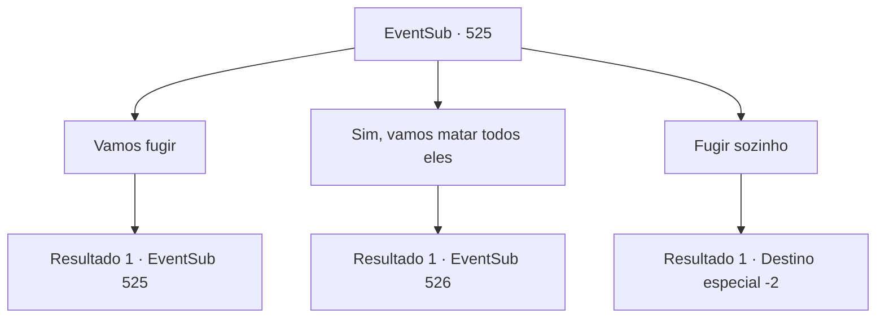

# Eventos secundários · 525

[Índice da tabela](index.md) · [Índice geral](../index.md)

ID: `pt:EventSub:525` · Fonte: `EventSub4` · Versão: 1.2.47.

Mapeamento estático dos arquivos; a disponibilidade e a execução dependem do estado da run.

## Texto do evento

*Sem texto no arquivo.*

## Dados de entrada

```json
{
  "id": 525,
  "grade": 1,
  "subEvent": "",
  "required": ""
}
```

## Mapa das escolhas



## Escolhas e resultados

### Escolha 1

Vamos fugir

Requisitos e outros campos da escolha:

```json
{
  "required": "5_464_0"
}
```

#### Resultado 1.1

Você diz a Ternach que vocês dois deveriam fugir. Ternach fica bravo e pergunta: 'Do que vocês estão falando?'. 

 "Fugir? Eu não posso fazer isso. Estou prestes a morrer aqui! Se vocês querem fugir, vão sozinhos!"


Continuação registrada: [Evento 525](0525.md) na mesma tabela.

```json
{
  "required": "",
  "chance": "1",
  "nextEvent": 525,
  "type": 2,
  "reward": "5_464_1"
}
```

### Escolha 2

Sim, vamos matar todos eles

Requisitos e outros campos da escolha:

```json
{
  "required": ""
}
```

#### Resultado 2.1

Você e Ternach saem correndo da caverna. E lá você encontra os anões de Radania novamente. |drawing_Urrvan| Eles aparecem com uma grande estrutura que você nunca viu antes. É um cilindro enorme feito de bronze. Você olha para o deserto e vê cerca de 10 cilindros enormes, cada um com quase 8 metros de comprimento. Ao lado desses cilindros estão várias balistas. 

 "Vocês são inimigos de Radania! Estamos aqui para nos livrar de vocês de uma vez por todas. Não vou deixar vocês nos intimidarem novamente!"

 Ternach rosna de volta, sem se abalar. 

 "Façam o que quiserem! Seus idiotas insignificantes!"

 Enquanto Ternach espalha suas asas, uma das balistas dispara um enorme arpão com uma corrente presa. As correntes envolvem o corpo de Ternach e impedem o dragão de decolar. 

 "Todos, disparem seus canhões!"

 Ao ouvir esse grito, os anões acendem os canhões de bronze.

Continuação registrada: [Evento 526](0526.md) na mesma tabela.

```json
{
  "required": "",
  "chance": "1",
  "nextEvent": 526,
  "type": 2,
  "reward": ""
}
```

### Escolha 3

Fugir sozinho

Requisitos e outros campos da escolha:

```json
{
  "required": ""
}
```

#### Resultado 3.1

Ternach sai sozinho para lutar contra os anões. Você foge. Atrás de você, uma explosão sacode o chão. Você ouve o estalar do trovão e do relâmpago.

Continuação registrada: [Destino especial `-2`](../destinos-especiais.md).

```json
{
  "required": "",
  "chance": "1",
  "nextEvent": -2,
  "type": 2,
  "reward": "12_9_-1|14_9_3|14_9_14"
}
```

## Referências que chegam a este evento

- [Evento 524 · escolha 1 · resultado 1](0524.md#escolha-1)
- [Evento 524 · escolha 1 · resultado 2](0524.md#escolha-1)
- [Evento 524 · escolha 2 · resultado 1](0524.md#escolha-2)
- [Evento 524 · escolha 2 · resultado 2](0524.md#escolha-2)
- [Evento 524 · escolha 2 · resultado 4](0524.md#escolha-2)
- [Evento 525 · escolha 1 · resultado 1](0525.md#escolha-1)
