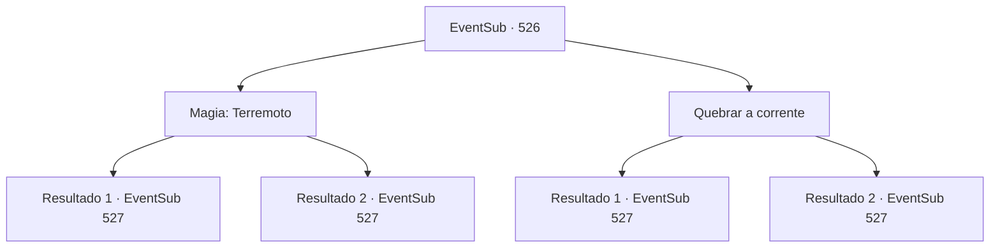

# Eventos secundários · 526

[Índice da tabela](index.md) · [Índice geral](../index.md)

ID: `pt:EventSub:526` · Fonte: `EventSub4` · Versão: 1.2.47.

Mapeamento estático dos arquivos; a disponibilidade e a execução dependem do estado da run.

## Texto do evento

*Sem texto no arquivo.*

## Dados de entrada

```json
{
  "id": 526,
  "grade": 1,
  "subEvent": "",
  "required": ""
}
```

## Mapa das escolhas



## Escolhas e resultados

### Escolha 1

Magia: Terremoto

Requisitos e outros campos da escolha:

```json
{
  "required": "20_0_4|1_1_2"
}
```

#### Resultado 1.1

Causa um terremoto nas dunas de areia. Então a areia treme e os canhões de bronze afundam nela. <b><link=shake> '¡Kabooom--!!!'</link></b> Os canhões estão todos tortos, disparando inofensivamente em diferentes direções. 

 "Meu Deus...!"

 Uma vez disparados, os canhões de bronze ficam vermelhos devido ao calor, o que dificulta recarregá-los. Os anões estão visivelmente envergonhados com isso. Mas eles não fogem. 

 "Não podemos sair ainda! Todos, avançar!"


Continuação registrada: [Evento 527](0527.md) na mesma tabela.

```json
{
  "required": "",
  "chance": "1|0_7_1|0_12_1",
  "nextEvent": 527,
  "type": 0,
  "reward": "6_2_159|0_1_-1",
  "place": 5
}
```

#### Resultado 1.2

Tentas causar um terremoto, mas falhas. <b><link=shake> 'Kabooom--!!!'</link></b> Os canhões de bronze disparam com um som explosivo. As bolas de ferro redondas voam pelo ar. Ternach cospe raios para tentar deter as balas de canhão, mas é impossível destruir as 10. As balas de canhão atingem Ternach, espalhando sangue e escamas azuis pela areia. 

 "Arrg-!! Esses anões!"

 Gotejando sangue, Ternach ruge. Uma vez disparados, os canhões de bronze ficam vermelhos devido ao calor, o que dificulta recarregá-los. Mas esse único ataque é suficiente. Ternach mal consegue se manter de pé. 

 "Como o canhão sabe 'Urr'? Hahaha! Todos, recarreguem!"


Continuação registrada: [Evento 527](0527.md) na mesma tabela.

```json
{
  "required": "",
  "chance": "26",
  "nextEvent": 527,
  "type": 1,
  "reward": "6_0_159|0_1_-1",
  "place": 5
}
```

### Escolha 2

Quebrar a corrente

Requisitos e outros campos da escolha:

```json
{
  "required": ""
}
```

#### Resultado 2.1

Você agarra as correntes que prendem as asas de Ternach. E quebra a corrente com grande força. Enquanto desamarra a asa direita de Ternach, ele consegue quebrar as correntes que envolvem a asa esquerda. Quase ao mesmo tempo, <b><link=shake> '¡Kabooom--!!!'</link></b> Os canhões de bronze disparam com um som explosivo. Bolas de ferro redondas voam pelo ar. Ternach te agarra e salta no ar. Os canhões de canhão atingem a areia onde você e Ternach estavam parados. Você consegue evitar o ataque iminente, mas Ternach é um alvo muito maior. Uma bala de canhão atinge a cauda do dragão. 

 "¡Arrg-!! ¡Esses anões!"

 Ternach perde o equilíbrio e cai no chão. A outra metade da cauda de Ternach rola pela areia. Uma vez disparados, os canhões de bronze ficam vermelhos devido ao calor, o que dificulta recarregá-los. 

 "¡Todos, avancem!"

 Talvez porque não possam mais se esconder atrás de seus canhões, os anões se apressam em sua direção e de Ternach.

Continuação registrada: [Evento 527](0527.md) na mesma tabela.

```json
{
  "required": "",
  "chance": "1|0_5_1",
  "nextEvent": 527,
  "type": 0,
  "reward": "6_2_159",
  "place": 5
}
```

#### Resultado 2.2

Você agarra as correntes que prendem as asas de Ternach. No entanto, não importa o quanto você tente, não consegue quebrá-las. <b><link=shake> 'Kabooom--!!!'</link></b> Os canhões de bronze disparam com um som explosivo. Bolas de ferro redondas voam pelo ar. Ternach cospe raios para tentar deter as balas de canhão, mas é impossível destruir as 10. As balas de canhão atingem Ternach, espalhando sangue e escamas azuis pela arena. 

 "Arrg-!! Esses anões!"

 Gotejando sangue, Ternach ruge. Uma vez disparados, os canhões de bronze ficam vermelhos devido ao calor, o que dificulta recarregá-los. Mas esse único ataque é suficiente. Ternach mal consegue se manter de pé. 

 "Como o canhão sabe 'Urr'? Hahaha! Todos, avancem!"


Continuação registrada: [Evento 527](0527.md) na mesma tabela.

```json
{
  "required": "",
  "chance": "30",
  "nextEvent": 527,
  "type": 1,
  "reward": "6_0_159",
  "place": 5
}
```

## Referências que chegam a este evento

- [Evento 523 · escolha 2 · resultado 1](0523.md#escolha-2)
- [Evento 525 · escolha 2 · resultado 1](0525.md#escolha-2)
