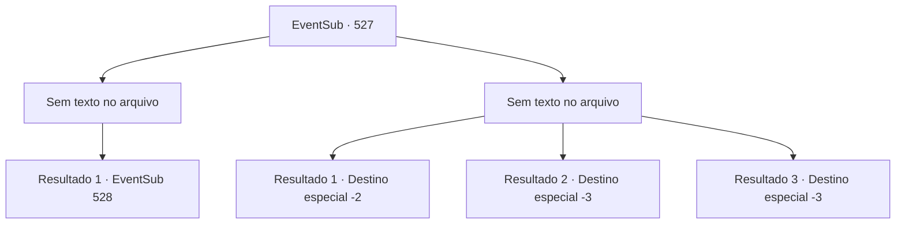

# Eventos secundários · 527

[Índice da tabela](index.md) · [Índice geral](../index.md)

ID: `pt:EventSub:527` · Fonte: `EventSub4` · Versão: 1.2.47.

Mapeamento estático dos arquivos; a disponibilidade e a execução dependem do estado da run.

## Texto do evento

*Sem texto no arquivo.*

## Dados de entrada

```json
{
  "id": 527,
  "grade": 1,
  "subEvent": "",
  "required": ""
}
```

## Mapa das escolhas



## Escolhas e resultados

### Escolha 1

*Sem texto no arquivo; o papel dessa opção depende da interface do jogo.*

Requisitos e outros campos da escolha:

```json
{
  "required": ""
}
```

#### Resultado 1.1

Você destroça o exército dos anões. A maioria deles acaba como cadáveres, e os poucos sobreviventes se dispersam e fogem. 

 "Nunca voltem aqui novamente!"

 Ternach grita com grande entusiasmo. No entanto, o dragão não parece bem. O corpo de Ternach está coberto de feridas e a cauda do dragão foi cortada. Talvez Ternach sinta seu olhar preocupado e te assegura que não é nada. 

 "Está bem. Vai sarar... Antes de você ir embora..."

 Ternach faz uma careta e se transforma em humano. Seu companheiro te pega pela mão e te leva de volta para a toca. Ternach se aproxima mancando de uma cômoda e começa a vasculhar uma gaveta. Você espera um pouco e então Ternach te mostra um anel com joias azuis. Ternach fala, chutando o chão sem motivo. 

 "Ouvi dizer que os humanos fazem isso..."

 E em voz mais baixa, murmura 'Por favor, aceite. Antes que meu braço caia'.

Continuação registrada: [Evento 528](0528.md) na mesma tabela.

```json
{
  "required": "",
  "chance": "1",
  "nextEvent": 528,
  "type": 2,
  "reward": ""
}
```

### Escolha 2

*Sem texto no arquivo; o papel dessa opção depende da interface do jogo.*

Requisitos e outros campos da escolha:

```json
{
  "required": ""
}
```

#### Resultado 2.1

Você cai no chão quando o martelo de um anão te atinge. Sangue quente escorre da sua testa. Você ouve Ternach gritando. 

 "Eu vou distraí-los, então se apresse e corra!"

 Então Ternach se lança contra os anões, cuspindo trovões. Você consegue se levantar, mas assim que fica de pé, sua visão escurece. 

 Sem saber quanto tempo passou, você levanta a cabeça para fora da areia. No começo parece que o sol se pôs sobre o deserto. Mas não é noite. É a asa de Ternach te cobrindo, bloqueando o sol. Você se arrasta sob as asas de Ternach e olha para o rosto do dragão. Os olhos de Ternach estão abertos, mas não há movimento. Não há respiração. E o chifre, a característica distintiva de um dragão azul, foi cortado. Você fecha os olhos de Ternach e vai embora.

Continuação registrada: [Destino especial `-2`](../destinos-especiais.md).

```json
{
  "required": "1_0_2|1_1_2",
  "chance": "1",
  "nextEvent": -2,
  "type": 2,
  "reward": "0_0_-1|0_1_-1|12_9_-1|14_9_3|14_9_14"
}
```

#### Resultado 2.2

Você cai no chão quando o martelo de um anão te atinge. Sangue quente escorre da sua testa. Você ouve Ternach gritando. 

 "Eu vou distraí-los, então se apresse e corra!"

 Então Ternach se lança em direção aos anões, cuspindo trovões. Você consegue se levantar, mas assim que fica de pé, sua visão escurece.

Continuação registrada: [Destino especial `-3`](../destinos-especiais.md).

```json
{
  "required": "2_0_2",
  "chance": "1",
  "nextEvent": -3,
  "type": 2,
  "reward": "0_0_-1|0_1_-1"
}
```

#### Resultado 2.3

Você cai no chão quando o martelo de um anão te atinge. Sangue quente escorre da sua testa. Você ouve Ternach gritando. 

 "Eu vou distraí-los, então se apresse e corra!"

 Então Ternach se lança em direção aos anões, cuspindo trovões. Você consegue se levantar, mas assim que fica de pé, sua visão escurece.

Continuação registrada: [Destino especial `-3`](../destinos-especiais.md).

```json
{
  "required": "2_1_2",
  "chance": "1",
  "nextEvent": -3,
  "type": 2,
  "reward": "0_0_-1|0_1_-1"
}
```

## Referências que chegam a este evento

- [Evento 526 · escolha 1 · resultado 1](0526.md#escolha-1)
- [Evento 526 · escolha 1 · resultado 2](0526.md#escolha-1)
- [Evento 526 · escolha 2 · resultado 1](0526.md#escolha-2)
- [Evento 526 · escolha 2 · resultado 2](0526.md#escolha-2)
