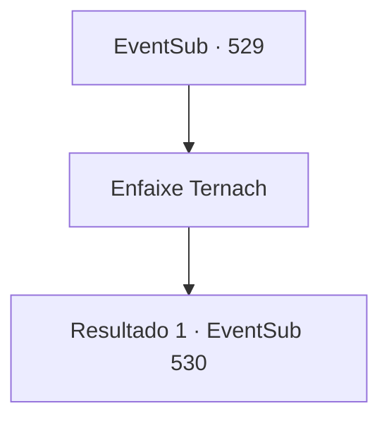

# Eventos secundários · 529

[Índice da tabela](index.md) · [Índice geral](../index.md)

ID: `pt:EventSub:529` · Fonte: `EventSub4` · Versão: 1.2.47.

Mapeamento estático dos arquivos; a disponibilidade e a execução dependem do estado da run.

## Texto do evento

*Sem texto no arquivo.*

## Dados de entrada

```json
{
  "id": 529,
  "grade": 1,
  "subEvent": "",
  "required": ""
}
```

## Mapa das escolhas



## Escolhas e resultados

### Escolha 1

Enfaixe Ternach

Requisitos e outros campos da escolha:

```json
{
  "required": ""
}
```

#### Resultado 1.1

Você aplica remédio nas feridas de Ternach e faz curativos. Pode ser que não funcione para os dragões, mas pelo menos está melhorando Ternach; Ternach rosna e se apoia em você, claramente de bom humor. De repente, você ouve a voz de Sartha. 

 "Ei! O que foi esse alvoroço? Os soldados de Radania vieram me resgatar?"

 Ao ouvir seu grito, Ternach suspira suavemente. 

 "Ah... O clima estava perfeito..."

 Quando não há resposta, Sartha grita novamente. 

 "Por favor... Por favor, me deixem sair!"


Continuação registrada: [Evento 530](0530.md) na mesma tabela.

```json
{
  "required": "",
  "chance": "1",
  "nextEvent": 530,
  "type": 2,
  "reward": ""
}
```

## Referências que chegam a este evento

- [Evento 521 · escolha 1 · resultado 1](0521.md#escolha-1)
- [Evento 521 · escolha 1 · resultado 2](0521.md#escolha-1)
