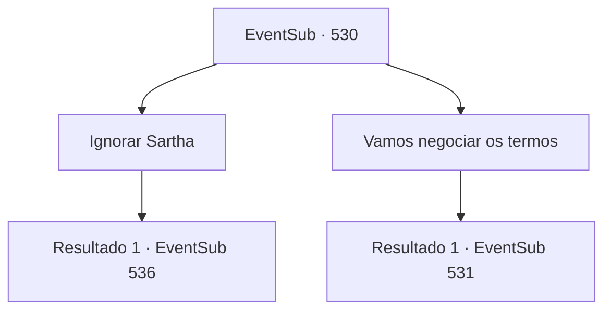

# Eventos secundários · 530

[Índice da tabela](index.md) · [Índice geral](../index.md)

ID: `pt:EventSub:530` · Fonte: `EventSub4` · Versão: 1.2.47.

Mapeamento estático dos arquivos; a disponibilidade e a execução dependem do estado da run.

## Texto do evento

*Sem texto no arquivo.*

## Dados de entrada

```json
{
  "id": 530,
  "grade": 1,
  "subEvent": "",
  "required": ""
}
```

## Mapa das escolhas



## Escolhas e resultados

### Escolha 1

Ignorar Sartha

Requisitos e outros campos da escolha:

```json
{
  "required": ""
}
```

#### Resultado 1.1

Decide ignorar Sartha. Sartha fica ainda mais barulhenta. Ela pede para ser libertada. Mas Ternach cobre o poço com pedras. Em seguida, Ternach rasteja até uma cômoda e começa a mexer em uma gaveta. Você espera um pouco e finalmente Ternach mostra um anel com joias azuis. Ternach fala, chutando o chão sem motivo. 

 "Ah, ouvi dizer que os humanos fazem isso..."

 E em voz mais baixa, murmura 'Por favor, aceite. Antes que meu braço caia'.

Continuação registrada: [Evento 536](0536.md) na mesma tabela.

```json
{
  "required": "",
  "chance": "1",
  "nextEvent": 536,
  "type": 2,
  "reward": ""
}
```

### Escolha 2

Vamos negociar os termos

Requisitos e outros campos da escolha:

```json
{
  "required": ""
}
```

#### Resultado 2.1

Você se aproxima do poço onde Sartha está presa e pergunta o que ela oferecerá em troca. Sartha emagreceu desde a última vez que você a viu. No entanto, ela sorri diante de sua pergunta e responde. 

 "Mesmo depois que você me libertar, prometo que nossos tributos serão tão grandes quanto são agora!"

 Ternach franze a testa diante dessa proposta. 

 "Como posso acreditar em você?"

 Sartha responde. 

 "Juro pela barba de Morodine, o criador dos anões! Acredite em mim! Quando eu voltar, certamente farei um tributo para você e estabelecerei um dia comemorativo para honrar sua misericórdia. 'O dia de Ternach'. O que você acha?"

 As comissuras da boca de Ternach se movem ligeiramente diante de suas palavras.

Continuação registrada: [Evento 531](0531.md) na mesma tabela.

```json
{
  "required": "",
  "chance": "1",
  "nextEvent": 531,
  "type": 2,
  "reward": ""
}
```

## Referências que chegam a este evento

- [Evento 529 · escolha 1 · resultado 1](0529.md#escolha-1)
