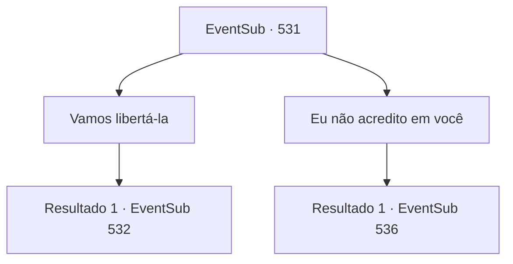

# Eventos secundários · 531

[Índice da tabela](index.md) · [Índice geral](../index.md)

ID: `pt:EventSub:531` · Fonte: `EventSub4` · Versão: 1.2.47.

Mapeamento estático dos arquivos; a disponibilidade e a execução dependem do estado da run.

## Texto do evento

*Sem texto no arquivo.*

## Dados de entrada

```json
{
  "id": 531,
  "grade": 1,
  "subEvent": "",
  "required": ""
}
```

## Mapa das escolhas



## Escolhas e resultados

### Escolha 1

Vamos libertá-la

Requisitos e outros campos da escolha:

```json
{
  "required": ""
}
```

#### Resultado 1.1

Ternach se senta na cama, pensando por um momento, antes de concordar. 

 "Tudo bem, então vamos juntos. Só me diga para onde levá-la."

 Ternach tira Sartha do poço. Ternach se transforma novamente em um dragão e ambos sobem e se preparam para decolar. 

 "Segure-se firme."


Continuação registrada: [Evento 532](0532.md) na mesma tabela.

```json
{
  "required": "",
  "chance": "1",
  "nextEvent": 532,
  "type": 2,
  "reward": ""
}
```

### Escolha 2

Eu não acredito em você

Requisitos e outros campos da escolha:

```json
{
  "required": ""
}
```

#### Resultado 2.1

Você não escolhe acreditar nas palavras de Sartha. Sartha implora ainda mais forte para que confie nela, mas Ternach cobre o poço com pedras. Em seguida, Ternach se aproxima de uma cômoda ao lado da cama e começa a revirar uma gaveta. Você espera um pouco e finalmente Ternach mostra um anel com joias azuis. Ternach fala, chutando o chão sem motivo. 

 "Ah, ouvi dizer que os humanos fazem isso..."

 E em voz mais baixa, murmura 'Por favor, aceite. Antes que meu braço caia'.

Continuação registrada: [Evento 536](0536.md) na mesma tabela.

```json
{
  "required": "",
  "chance": "1",
  "nextEvent": 536,
  "type": 2,
  "reward": ""
}
```

## Referências que chegam a este evento

- [Evento 530 · escolha 2 · resultado 1](0530.md#escolha-2)
