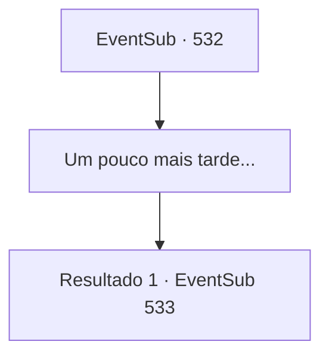

# Eventos secundários · 532

[Índice da tabela](index.md) · [Índice geral](../index.md)

ID: `pt:EventSub:532` · Fonte: `EventSub4` · Versão: 1.2.47.

Mapeamento estático dos arquivos; a disponibilidade e a execução dependem do estado da run.

## Texto do evento

*Sem texto no arquivo.*

## Dados de entrada

```json
{
  "id": 532,
  "grade": 1,
  "subEvent": "",
  "required": ""
}
```

## Mapa das escolhas



## Escolhas e resultados

### Escolha 1

Um pouco mais tarde...

Requisitos e outros campos da escolha:

```json
{
  "required": ""
}
```

#### Resultado 1.1

Ternach aterriza na mansão do Senhor Radania. Com a chegada do dragão azul, os anões próximos ficam atônitos e pegam suas armas. Suas expressões estão cheias de medo. Em pé na frente deles está um anão com uma elegante armadura negra. Em seguida, Sartha desliza das costas de Ternach e fica na frente deles. 

 "Todos! Eu voltei!"

 O anão de armadura negra abraça Sartha com os braços abertos. 

 "Oh, meu tesouro! Meu bebê!"

 Parece ser o pai de Sartha, Radan Tess. Você desce das costas de Ternach enquanto o pai e a filha se reencontram. 

 "No entanto... Você realmente mudou de ideia e decidiu devolver minha filha? O dragão azul não faria isso de graça..."

 Então Sartha sussurra algo para ele. Depois de um momento, Radan Tess acaricia sua barba. 

 "Hmm... Então vamos fazer isso. Agora, vamos entrar e discutir os detalhes."

 Após terminar sua declaração, Tess toma a frente e entra em sua mansão.

Continuação registrada: [Evento 533](0533.md) na mesma tabela.

```json
{
  "required": "",
  "chance": "1",
  "nextEvent": 533,
  "type": 2,
  "reward": ""
}
```

## Referências que chegam a este evento

- [Evento 531 · escolha 1 · resultado 1](0531.md#escolha-1)
