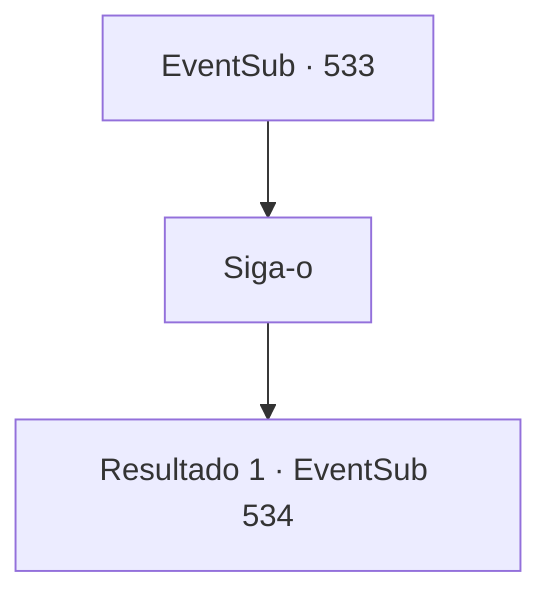

# Eventos secundários · 533

[Índice da tabela](index.md) · [Índice geral](../index.md)

ID: `pt:EventSub:533` · Fonte: `EventSub4` · Versão: 1.2.47.

Mapeamento estático dos arquivos; a disponibilidade e a execução dependem do estado da run.

## Texto do evento

*Sem texto no arquivo.*

## Dados de entrada

```json
{
  "id": 533,
  "grade": 1,
  "subEvent": "",
  "required": ""
}
```

## Mapa das escolhas



## Escolhas e resultados

### Escolha 1

Siga-o

Requisitos e outros campos da escolha:

```json
{
  "required": ""
}
```

#### Resultado 1.1

Você entra na mansão construída de cobre e aço. A mansão está decorada com muitas estátuas esculpidas em prata, ouro e outros metais preciosos. Ternach se transforma em humano e te segue. Tess te leva para uma sala de jantar. 

 "De acordo... honraremos suas demandas..."

 Tess pega um pergaminho e redige um contrato antes de entregá-lo a Ternach. Ternach o revisa e depois te passa. Você verifica o conteúdo do contrato. O contrato estabelece que Radania fará um tributo anual a Ternach enquanto Sartha estiver viva, e designarão esse dia como uma celebração em honra a Ternach. 

 "Certo. Assine o contrato aqui."

 Tess assina o pergaminho e Ternach faz o mesmo. Imediatamente depois, Tess abre a boca. 

 "Muito bem, temos um acordo. Aqueles que quebrarem este contrato serão amaldiçoados por Morodine. Ternach, construiremos um lugar para você ficar aqui. Eu te chamarei quando estiver pronto. Por favor, vá agora."

 Você sai da mansão de Radan com Ternach, e Sartha se despede de você. 

 "Obrigado por me salvar, {1}. Pegue isso antes de ir embora."

 Ela te entrega uma bolsa pesada, dizendo que é um sinal de sua sincera gratidão.

Continuação registrada: [Evento 534](0534.md) na mesma tabela.

```json
{
  "required": "",
  "chance": "1",
  "nextEvent": 534,
  "type": 2,
  "reward": ""
}
```

## Referências que chegam a este evento

- [Evento 532 · escolha 1 · resultado 1](0532.md#escolha-1)
