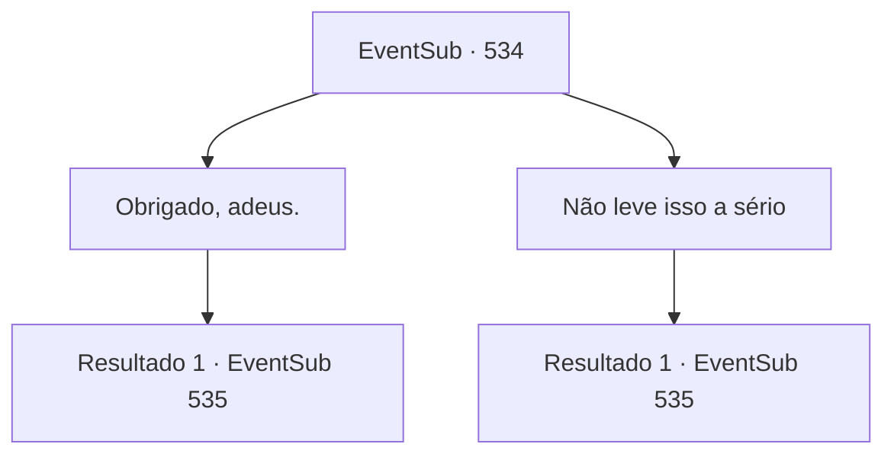

# Eventos secundários · 534

[Índice da tabela](index.md) · [Índice geral](../index.md)

ID: `pt:EventSub:534` · Fonte: `EventSub4` · Versão: 1.2.47.

Mapeamento estático dos arquivos; a disponibilidade e a execução dependem do estado da run.

## Texto do evento

*Sem texto no arquivo.*

## Dados de entrada

```json
{
  "id": 534,
  "grade": 1,
  "subEvent": "",
  "required": ""
}
```

## Mapa das escolhas



## Escolhas e resultados

### Escolha 1

Obrigado, adeus.

Requisitos e outros campos da escolha:

```json
{
  "required": ""
}
```

#### Resultado 1.1

Você aceita o presente dele. Há bastante ouro na bolsa que ele te entregou. Sartha se curva e fecha a porta. Assim que Sartha sai, Ternach se dirige a você. 

 "Ah... tenho algo para te dar."

 Ternach estende um anel com joias azuis. 

 "Ah, ouvi dizer que os humanos fazem isso..."

 Os humanos normalmente não fazem isso na frente das casas de outras pessoas, mas o dragão parece não saber disso. Ternach chuta o chão sem motivo. E em voz mais baixa, murmura 'Por favor, aceite. Antes que meu braço caia'.

Continuação registrada: [Evento 535](0535.md) na mesma tabela.

```json
{
  "required": "",
  "chance": "1",
  "nextEvent": 535,
  "type": 2,
  "reward": "0_4_50"
}
```

### Escolha 2

Não leve isso a sério

Requisitos e outros campos da escolha:

```json
{
  "required": "1_3_0"
}
```

#### Resultado 2.1

Você rejeita o presente dele, dizendo que não esperava ser recompensado por ajudá-lo. 

 "Oh... entendo. Então, considerarei você um amigo da minha família. Por favor, venha me visitar quando quiser."

 Sartha faz uma reverência e fecha a porta. Assim que Sartha sai, Ternach se dirige a você. 

 "Ah... tenho algo para te dar."

 Ternach estende um anel com joias azuis. 

 "Ah, ouvi dizer que os humanos fazem isso..."

 Os humanos normalmente não fazem isso na frente das casas de outras pessoas, mas o dragão parece não saber disso. Ternach chuta o chão sem motivo. E em voz mais baixa, murmura 'Por favor, aceite. Antes que meu braço caia'.

Continuação registrada: [Evento 535](0535.md) na mesma tabela.

```json
{
  "required": "",
  "chance": "1",
  "nextEvent": 535,
  "type": 2,
  "reward": "0_3_10|14_9_5"
}
```

## Referências que chegam a este evento

- [Evento 533 · escolha 1 · resultado 1](0533.md#escolha-1)
