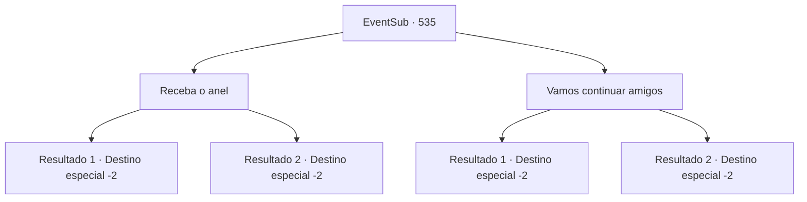

# Eventos secundários · 535

[Índice da tabela](index.md) · [Índice geral](../index.md)

ID: `pt:EventSub:535` · Fonte: `EventSub4` · Versão: 1.2.47.

Mapeamento estático dos arquivos; a disponibilidade e a execução dependem do estado da run.

## Texto do evento

*Sem texto no arquivo.*

## Dados de entrada

```json
{
  "id": 535,
  "grade": 1,
  "subEvent": "",
  "required": ""
}
```

## Mapa das escolhas



## Escolhas e resultados

### Escolha 1

Receba o anel

Requisitos e outros campos da escolha:

```json
{
  "required": "24_1_1"
}
```

#### Resultado 1.1

Você aceita o anel de Ternach. Ela sorri brilhantemente. 

 "Então... suponho que posso chamá-los de queridos...?"

 Ela fala casualmente, olhando para você com carinho. 

 "Hmm... Acho que devo ajudá-los a construir minha casa. Porque não confio que esses anões farão um trabalho bom o suficiente... De qualquer forma, fiquem seguros e voltem logo. Estarei esperando por vocês."

 Você se despede dela.

Continuação registrada: [Destino especial `-2`](../destinos-especiais.md).

```json
{
  "required": "11_0_0",
  "chance": "1",
  "nextEvent": -2,
  "type": 2,
  "reward": "12_9_-1|14_9_4|14_9_1|14_9_10|3_254_1|5_465_1"
}
```

#### Resultado 1.2

Você aceita o anel de Ternach. Ele sorri brilhantemente. 

 "Então... Acho que posso chamá-los de querido...?"

 Ele fala casualmente, olhando para você com carinho. 

 "Hmm... Acho que devo ajudá-los a construir minha casa. Porque não confio que esses anões farão um trabalho bom o suficiente... De qualquer forma, fiquem seguros e voltem logo. Estarei esperando por vocês."

 Você se despede dele.

Continuação registrada: [Destino especial `-2`](../destinos-especiais.md).

```json
{
  "required": "11_0_1",
  "chance": "1",
  "nextEvent": -2,
  "type": 2,
  "reward": "12_9_-1|14_9_2|14_9_1|14_9_10|3_254_1|5_465_1"
}
```

### Escolha 2

Vamos continuar amigos

Requisitos e outros campos da escolha:

```json
{
  "required": ""
}
```

#### Resultado 2.1

Você não aceita o anel que Ternach te oferece. As pálpebras dele tremem. 

 "Oh... Não, por quê...? Espere, irmão, você não gosta de mim?"

 Você o consola e explica que ainda quer ser amigos. Então você vai embora. 

 "Não... Não posso desistir assim."

 Você ouve os choros dele atrás de você.

Continuação registrada: [Destino especial `-2`](../destinos-especiais.md).

```json
{
  "required": "11_0_0",
  "chance": "1",
  "nextEvent": -2,
  "type": 2,
  "reward": "12_9_-1|14_9_1|14_9_10|14_9_11"
}
```

#### Resultado 2.2

Você não aceita o anel que Ternach te oferece. As pálpebras dele tremem. 

 "Oh... Não, por quê...? Espere, irmã, você não gosta de mim?"

 Você o consola e explica que ainda gostaria de ser amigos. Então você vai embora. 

 "Não... Não posso desistir assim."

 Você ouve ele chorando atrás de você.

Continuação registrada: [Destino especial `-2`](../destinos-especiais.md).

```json
{
  "required": "11_0_1",
  "chance": "1",
  "nextEvent": -2,
  "type": 2,
  "reward": "12_9_-1|14_9_1|14_9_10|14_9_11"
}
```

## Referências que chegam a este evento

- [Evento 534 · escolha 1 · resultado 1](0534.md#escolha-1)
- [Evento 534 · escolha 2 · resultado 1](0534.md#escolha-2)
