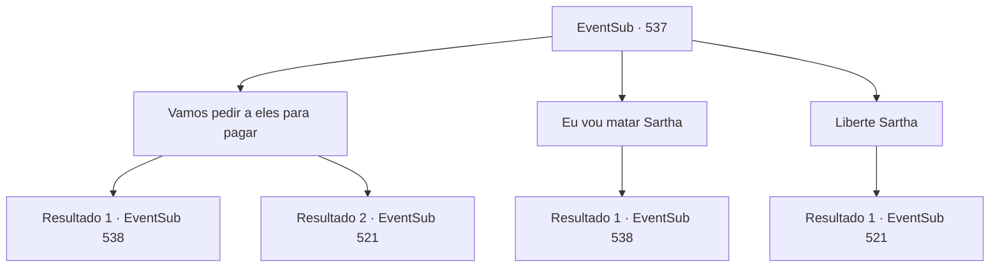

# Eventos secundários · 537

[Índice da tabela](index.md) · [Índice geral](../index.md)

ID: `pt:EventSub:537` · Fonte: `EventSub4` · Versão: 1.2.47.

Mapeamento estático dos arquivos; a disponibilidade e a execução dependem do estado da run.

## Texto do evento

*Sem texto no arquivo.*

## Dados de entrada

```json
{
  "id": 537,
  "grade": 1,
  "subEvent": "",
  "required": ""
}
```

## Mapa das escolhas



## Escolhas e resultados

### Escolha 1

Vamos pedir a eles para pagar

Requisitos e outros campos da escolha:

```json
{
  "required": ""
}
```

#### Resultado 1.1

Diz a Ternach para pedir um resgate em troca de Sartha. Ternach parece indeciso, mas finalmente concorda com a cabeça. Você se dirige aos anões com habilidade, expressando sua lealdade e afeto por Sartha enquanto exige o pagamento. Eles concordam e aceitam. 

 "Se for para salvar Sartha, daremos tudo o que temos. Daremos todas as armaduras e armas que fizemos nós mesmos e todo o ouro que temos."

 Eles tiram suas armaduras e armas e as colocam na sua frente. Quando você olha para Ternach, o vê radiante de satisfação. 

 "Nesse caso, não posso evitar."

 Ternach liberta Sartha. Os anões recebem Sartha, chorando emocionados. 

 "Obrigado por vir me salvar."

 Sartha e os anões desaparecem entre as dunas de areia, cantando alegremente. Nesse momento, você percebe que Ternach está olhando fixamente para você.

Continuação registrada: [Evento 538](0538.md) na mesma tabela.

```json
{
  "required": "",
  "chance": "1|0_7_1",
  "nextEvent": 538,
  "type": 0,
  "reward": ""
}
```

#### Resultado 1.2

Dices a Ternach para pedir um resgate em troca de Sartha. Ternach parece indeciso, mas finalmente concorda com a cabeça. Mas os anões não são tão complacentes. Eles gritam de raiva. 

 "Ela não te pertence, como você espera que a compremos de você?"

 Eles empunham suas armas e partem para o ataque. Uma briga parece inevitável.

Continuação registrada: [Evento 521](0521.md) na mesma tabela.

```json
{
  "required": "",
  "chance": "15",
  "nextEvent": 521,
  "type": 1,
  "reward": "6_0_159",
  "place": 5
}
```

### Escolha 2

Eu vou matar Sartha

Requisitos e outros campos da escolha:

```json
{
  "required": "2_3_-14"
}
```

#### Resultado 2.1

Você dá aos anões um aviso assustador. Ternach ecoa suas ameaças. 

 "Quando eu luto com você... eu não sei quem vai morrer."

 Os anões tremem por trás de suas barbas. Então um deles grita. 

 "Tudo bem então! Mostre-nos que a senhora Sartha está viva!"

 Ternach aceita e usa magia para retratar Sartha. Os anões derramam lágrimas ao ver Sartha. 

 "Oh, meu Deus...! Senhora Sartha!"

 Ternach se dirige a eles com voz fria. 

 "Eu me certificarei de que eles venham prestar homenagem. Não tenham medo e esqueçam."

 Os anões apertam os dentes, mas são obrigados a recuar. Eles se afastam, olhando para você com ódio em seus olhos. Você se vira para Ternach, que se esfrega em você carinhosamente. Você pode sentir as escamas duras e lisas. 

 "Agora que os anões se foram... já que todos estão aqui, vocês querem passar um tempo juntos?"


Continuação registrada: [Evento 538](0538.md) na mesma tabela.

```json
{
  "required": "",
  "chance": "1",
  "nextEvent": 538,
  "type": 2,
  "reward": ""
}
```

### Escolha 3

Liberte Sartha

Requisitos e outros campos da escolha:

```json
{
  "required": ""
}
```

#### Resultado 3.1

Sugeres que Ternach liberte Sartha, Mas Ternach se recusa imediatamente. 

 "Do que estás falando? Prefiro morrer antes de fazer isso!"

 Após ouvir a resposta de Ternach, os anões se apressam, gritando. 'Então morra!'

Continuação registrada: [Evento 521](0521.md) na mesma tabela.

```json
{
  "required": "",
  "chance": "1",
  "nextEvent": 521,
  "type": 2,
  "reward": "6_0_159",
  "place": 5
}
```

## Referências que chegam a este evento

- [Evento 516 · escolha 2 · resultado 1](0516.md#escolha-2)
- [Evento 520 · escolha 2 · resultado 1](0520.md#escolha-2)
