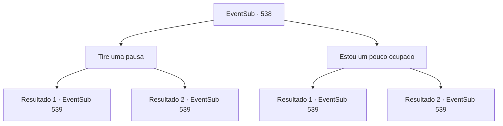

# Eventos secundários · 538

[Índice da tabela](index.md) · [Índice geral](../index.md)

ID: `pt:EventSub:538` · Fonte: `EventSub4` · Versão: 1.2.47.

Mapeamento estático dos arquivos; a disponibilidade e a execução dependem do estado da run.

## Texto do evento

*Sem texto no arquivo.*

## Dados de entrada

```json
{
  "id": 538,
  "grade": 1,
  "subEvent": "",
  "required": ""
}
```

## Mapa das escolhas



## Escolhas e resultados

### Escolha 1

Tire uma pausa

Requisitos e outros campos da escolha:

```json
{
  "required": ""
}
```

#### Resultado 1.1

Você segue Ternach até sua toca. Ao contrário antes, há objetos humanos e móveis por toda a caverna. Ternach se transforma em uma figura humana e se senta em uma cama. Ela faz gestos com as mãos. 

 "Irmão, venha aqui. Por favor."

 Você se senta ao lado de Ternach. Ela tira algo de uma gaveta da cômoda ao lado da cama e te oferece. É um anel com joias azuis. 

 "Ah, ouvi dizer que os humanos fazem isso..."

 Ternach fala, chutando o chão sem rumo. E em voz mais baixa, murmura 'Por favor, aceite. Antes que meu braço caia'.

Continuação registrada: [Evento 539](0539.md) na mesma tabela.

```json
{
  "required": "11_0_0",
  "chance": "1",
  "nextEvent": 539,
  "type": 2,
  "reward": ""
}
```

#### Resultado 1.2

Você segue Ternach até sua toca. Ao contrário antes, há objetos humanos e móveis por toda a caverna. Ternach se transforma em uma figura humana e se senta em uma cama. Ele faz gestos com as mãos. 

 "Irmã, venha aqui. Por favor."

 Você se senta ao lado de Ternach. Ele tira algo de uma gaveta da cômoda ao lado da cama e te oferece. É um anel com joias azuis. 

 "Ah, ouvi dizer que os humanos fazem isso..."

 Ternach fala, chutando o chão sem rumo. E em voz mais baixa, murmura 'Por favor, aceite. Antes que meu braço caia'.

Continuação registrada: [Evento 539](0539.md) na mesma tabela.

```json
{
  "required": "11_0_1",
  "chance": "1",
  "nextEvent": 539,
  "type": 2,
  "reward": ""
}
```

### Escolha 2

Estou um pouco ocupado

Requisitos e outros campos da escolha:

```json
{
  "required": ""
}
```

#### Resultado 2.1

Você rejeita a oferta de Ternach. Ternach responde com um olhar de vergonha. 

 "Oh... Então, por favor, espere um minuto. Tenho algo para te dar."

 Ternach se apressa em direção ao seu esconderijo. Um momento passa e então Ternach retorna. Ele mudou para sua forma humana. 

 "E... Isso..."

 Ela estende um anel com joias azuis. E em voz mais baixa, murmura 'Por favor, aceite. Antes que meu braço caia'.

Continuação registrada: [Evento 539](0539.md) na mesma tabela.

```json
{
  "required": "11_0_0",
  "chance": "1",
  "nextEvent": 539,
  "type": 2,
  "reward": ""
}
```

#### Resultado 2.2

Você rejeita a oferta de Ternach. Ternach responde com um olhar de vergonha. 

 "Oh... Então, por favor, espere um minuto. Tenho algo para te dar."

 Ternach se apressa em direção ao seu esconderijo. Um momento passa e então Ternach retorna. Ele mudou para sua forma humana. 

 "E... Isso..."

 Ele estende um anel com joias azuis. E em voz mais baixa, murmura 'Por favor, aceite. Antes que meu braço caia'.

Continuação registrada: [Evento 539](0539.md) na mesma tabela.

```json
{
  "required": "11_0_1",
  "chance": "1",
  "nextEvent": 539,
  "type": 2,
  "reward": ""
}
```

## Referências que chegam a este evento

- [Evento 537 · escolha 1 · resultado 1](0537.md#escolha-1)
- [Evento 537 · escolha 2 · resultado 1](0537.md#escolha-2)
