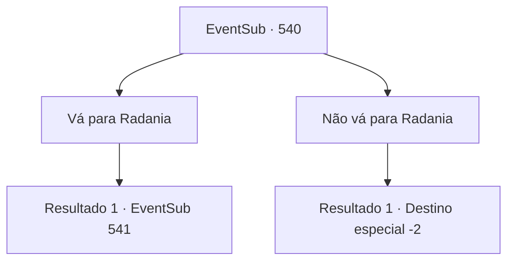

# Eventos secundários · 540

[Índice da tabela](index.md) · [Índice geral](../index.md)

ID: `pt:EventSub:540` · Fonte: `EventSub4` · Versão: 1.2.47.

Mapeamento estático dos arquivos; a disponibilidade e a execução dependem do estado da run.

## Texto do evento

Você se depara com Radania, o território dos Anões em uma montanha rochosa. Você se lembra que depois de ter salvado a Lady Sartha, aqueles homens a levaram.

## Dados de entrada

```json
{
  "id": 540,
  "grade": 1,
  "subEvent": "",
  "required": "12_9_6|1_2_40"
}
```

## Mapa das escolhas



## Escolhas e resultados

### Escolha 1

Vá para Radania

Requisitos e outros campos da escolha:

```json
{
  "required": ""
}
```

#### Resultado 1.1

Radania é uma fortaleza em uma enorme montanha rochosa, governada pelo senhor anão. As paredes cinzentas cercam a área. Um sistema de trilhos que sai das minas atravessa a vila. E no ponto mais alto do assentamento está a mansão do Senhor de Radania. |drawing_Radania| Há cartazes por toda Radania indicando que ainda estão procurando por Sartha. Parece que Sartha ainda não voltou para casa. Enquanto você está olhando ao redor, vê um anão com armadura negra. Ele usa uma luva enorme quase tão grande quanto ele, que é tão chamativa quanto sua armadura ornamentada completa. Há assistentes ao seu redor tentando impedi-lo. 

 "Oh, meu senhor! Você não pode ir sozinho. De jeito nenhum, senhor!"

 Isso enfurece o anão. 

 "Não posso esperar mais! Não me impeça! Vou encontrar minha filha por mim mesmo!"


Continuação registrada: [Evento 541](0541.md) na mesma tabela.

```json
{
  "required": "",
  "chance": "1",
  "nextEvent": 541,
  "type": 2,
  "reward": ""
}
```

### Escolha 2

Não vá para Radania

Requisitos e outros campos da escolha:

```json
{
  "required": ""
}
```

#### Resultado 2.1

Decide não visitar Radania. Em vez disso, você passa direto e continua sua viagem.

Continuação registrada: [Destino especial `-2`](../destinos-especiais.md).

```json
{
  "required": "",
  "chance": "1",
  "nextEvent": -2,
  "type": 2,
  "reward": "12_9_-1|14_9_12"
}
```

## Referências que chegam a este evento

Nenhum `nextEvent` positivo da mesma tabela aponta para este nó. Isso não prova que seja inacessível: sorteio e estado de história podem selecioná-lo.

