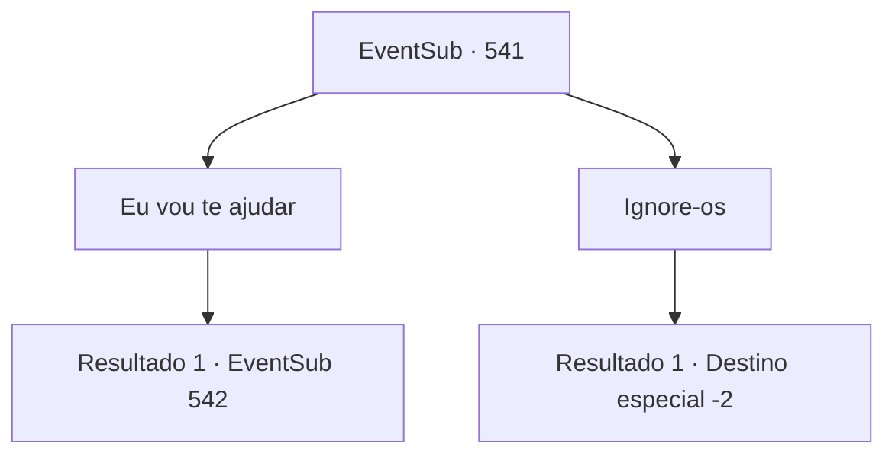

# Eventos secundários · 541

[Índice da tabela](index.md) · [Índice geral](../index.md)

ID: `pt:EventSub:541` · Fonte: `EventSub4` · Versão: 1.2.47.

Mapeamento estático dos arquivos; a disponibilidade e a execução dependem do estado da run.

## Texto do evento

*Sem texto no arquivo.*

## Dados de entrada

```json
{
  "id": 541,
  "grade": 1,
  "subEvent": "",
  "required": ""
}
```

## Mapa das escolhas



## Escolhas e resultados

### Escolha 1

Eu vou te ajudar

Requisitos e outros campos da escolha:

```json
{
  "required": ""
}
```

#### Resultado 1.1

Você se aproxima do senhor de Radania e diz que ajudará a encontrar Sartha. 

 "... o que você está fazendo?"

 Ele te olha com as sobrancelhas levantadas. Um dos assistentes ao seu lado se curva e explica quem você é. 

 "Radan Tess, senhor. {1} é um aventureiro bastante famoso."

 Depois de ouvir seu assistente, o senhor te olha de cima a baixo. 

 "Como exatamente você vai me ajudar?"


Continuação registrada: [Evento 542](0542.md) na mesma tabela.

```json
{
  "required": "",
  "chance": "1",
  "nextEvent": 542,
  "type": 2,
  "reward": ""
}
```

### Escolha 2

Ignore-os

Requisitos e outros campos da escolha:

```json
{
  "required": ""
}
```

#### Resultado 2.1

Você os ignora. O senhor luta contra seus assistentes e finalmente consegue sair de Radania. Outros anões os observam partir com expressões ansiosas.

Continuação registrada: [Destino especial `-2`](../destinos-especiais.md).

```json
{
  "required": "",
  "chance": "1",
  "nextEvent": -2,
  "type": 2,
  "reward": "12_9_-1|14_9_12"
}
```

## Referências que chegam a este evento

- [Evento 540 · escolha 1 · resultado 1](0540.md#escolha-1)
