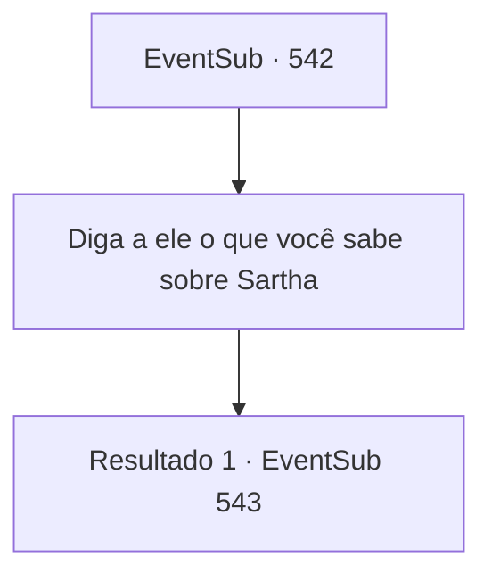

# Eventos secundários · 542

[Índice da tabela](index.md) · [Índice geral](../index.md)

ID: `pt:EventSub:542` · Fonte: `EventSub4` · Versão: 1.2.47.

Mapeamento estático dos arquivos; a disponibilidade e a execução dependem do estado da run.

## Texto do evento

*Sem texto no arquivo.*

## Dados de entrada

```json
{
  "id": 542,
  "grade": 1,
  "subEvent": "",
  "required": ""
}
```

## Mapa das escolhas



## Escolhas e resultados

### Escolha 1

Diga a ele o que você sabe sobre Sartha

Requisitos e outros campos da escolha:

```json
{
  "required": ""
}
```

#### Resultado 1.1

Você diz que salvou Sartha e foi para Antitikarr, mas ela foi levada por assassinos.  Radan Tess assente depois que você fala. 

 "Hmm... Isso parece bastante plausível. Mas, como posso saber se você está dizendo a verdade?"


Continuação registrada: [Evento 543](0543.md) na mesma tabela.

```json
{
  "required": "",
  "chance": "1",
  "nextEvent": 543,
  "type": 2,
  "reward": ""
}
```

## Referências que chegam a este evento

- [Evento 541 · escolha 1 · resultado 1](0541.md#escolha-1)
