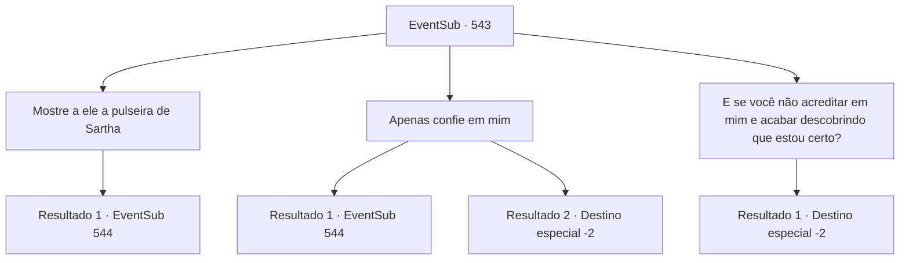

# Eventos secundários · 543

[Índice da tabela](index.md) · [Índice geral](../index.md)

ID: `pt:EventSub:543` · Fonte: `EventSub4` · Versão: 1.2.47.

Mapeamento estático dos arquivos; a disponibilidade e a execução dependem do estado da run.

## Texto do evento

*Sem texto no arquivo.*

## Dados de entrada

```json
{
  "id": 543,
  "grade": 1,
  "subEvent": "",
  "required": ""
}
```

## Mapa das escolhas



## Escolhas e resultados

### Escolha 1

Mostre a ele a pulseira de Sartha

Requisitos e outros campos da escolha:

```json
{
  "required": "8_255_1"
}
```

#### Resultado 1.1

Você mostra a pulseira que Sartha havia deixado cair. Os olhos de Tess se abrem enquanto ela olha para ela. 

 "Esta é a pulseira que dei a Sartha! Você deve tê-la conhecido de verdade. Tudo bem, vou acreditar em você. Venha comigo!"

 Ele fala com grande entusiasmo, tão animado que saliva espirra de sua boca. No entanto, o assistente ao seu lado o impede. 

 "Senhor, você não sabe quanto tempo isso levará. Como Radania pode sobreviver sem seu líder? Seria melhor deixar isso nas mãos de outra pessoa..."

 Radan Tess fica furioso com o assistente. 

 "Eu deixei nas mãos de outra pessoa, mas veja como isso acabou!"


Continuação registrada: [Evento 544](0544.md) na mesma tabela.

```json
{
  "required": "",
  "chance": "1",
  "nextEvent": 544,
  "type": 2,
  "reward": ""
}
```

### Escolha 2

Apenas confie em mim

Requisitos e outros campos da escolha:

```json
{
  "required": ""
}
```

#### Resultado 2.1

Você olha nos olhos de Tess e pede para que ela acredite em você. Ela olha fixamente para você e concorda. 

 "Tudo bem, vou confiar em você. Venha comigo!"

 No entanto, o assistente ao lado o impede. 

 "Senhor, você não sabe quanto tempo isso levará. Como Radania pode sobreviver sem seu líder? Seria melhor deixar nas mãos de outra pessoa..."

 Radan Tess está furioso com o assistente. 

 "Eu deixei nas mãos de outra pessoa, mas veja como isso acabou!"


Continuação registrada: [Evento 544](0544.md) na mesma tabela.

```json
{
  "required": "",
  "chance": "1|0_12_1",
  "nextEvent": 544,
  "type": 0,
  "reward": ""
}
```

#### Resultado 2.2

Você olha nos olhos de Tess e pede para ela acreditar nisso. Ela te encara intensamente e então balança a cabeça negativamente. 

 "Por que eu deveria fazer isso?"

 Tess resmunga enquanto passa por você, dizendo que encontrará Sartha por si mesma. O senhor luta contra seus assistentes e finalmente consegue sair de Radania. Outros anões os observam partindo com expressões ansiosas.

Continuação registrada: [Destino especial `-2`](../destinos-especiais.md).

```json
{
  "required": "",
  "chance": "10",
  "nextEvent": -2,
  "type": 1,
  "reward": "12_9_-1|14_9_12"
}
```

### Escolha 3

E se você não acreditar em mim e acabar descobrindo que estou certo?

Requisitos e outros campos da escolha:

```json
{
  "required": ""
}
```

#### Resultado 3.1

Tess resmunga diante de suas palavras. 

 "Hmph. Você está mentindo. Já tive o suficiente de pessoas como você."

 Tess murmura enquanto passa por você, dizendo que encontrará Sartha por si mesmo. O senhor luta contra seus assistentes e finalmente consegue sair de Radania. Outros anões os observam partir com expressões ansiosas.

Continuação registrada: [Destino especial `-2`](../destinos-especiais.md).

```json
{
  "required": "",
  "chance": "1",
  "nextEvent": -2,
  "type": 2,
  "reward": "12_9_-1|14_9_12"
}
```

## Referências que chegam a este evento

- [Evento 542 · escolha 1 · resultado 1](0542.md#escolha-1)
