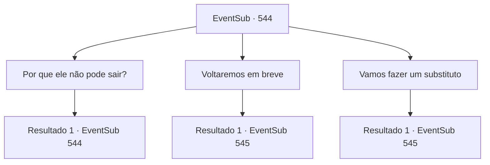

# Eventos secundários · 544

[Índice da tabela](index.md) · [Índice geral](../index.md)

ID: `pt:EventSub:544` · Fonte: `EventSub4` · Versão: 1.2.47.

Mapeamento estático dos arquivos; a disponibilidade e a execução dependem do estado da run.

## Texto do evento

*Sem texto no arquivo.*

## Dados de entrada

```json
{
  "id": 544,
  "grade": 1,
  "subEvent": "",
  "required": ""
}
```

## Mapa das escolhas



## Escolhas e resultados

### Escolha 1

Por que ele não pode sair?

Requisitos e outros campos da escolha:

```json
{
  "required": "5_466_0"
}
```

#### Resultado 1.1

O assistente te repreende por fazer uma pergunta assim. 

 "Se o senhor estiver ausente por muito tempo, nosso povo ficará ansioso e seremos mais vulneráveis a uma invasão."


Continuação registrada: [Evento 544](0544.md) na mesma tabela.

```json
{
  "required": "",
  "chance": "1",
  "nextEvent": 544,
  "type": 2,
  "reward": "5_466_1"
}
```

### Escolha 2

Voltaremos em breve

Requisitos e outros campos da escolha:

```json
{
  "required": ""
}
```

#### Resultado 2.1

Você promete que não estará ausente por muito tempo. O assistente reflete sobre isso por um momento. 

 "Ha... Acredito que posso esconder sua ausência por alguns meses, mas depois disso será muito difícil, meu senhor."

 Tess concorda enfaticamente e te insta a acompanhá-lo. 

 "Vamos, vamos para Antitikarr."

 Você e Tess passam pelas cocheiras e alugam uma mula. Ambos sobem nas costas da mula e seguem para Antitikarr.

Continuação registrada: [Evento 545](0545.md) na mesma tabela.

```json
{
  "required": "",
  "chance": "1",
  "nextEvent": 545,
  "type": 2,
  "reward": ""
}
```

### Escolha 3

Vamos fazer um substituto

Requisitos e outros campos da escolha:

```json
{
  "required": "1_14_12"
}
```

#### Resultado 3.1

Você propõe que alguém finja ser Tess enquanto ele está ausente. Tess acha que é uma boa ideia. 

 "Você pode até usar meu capacete!"

 Tess se aproxima do funcionário, que tenta afastá-lo com a mão. 

 "Como eu poderia..."

 Mas suas palavras não conseguem mudar a mente de Tess. Tess já colocou seu capacete na cabeça do funcionário. 

 "Voltarei em breve. Obrigado pelo seu trabalho árduo. Vamos. Vamos para Antitikarr."


Continuação registrada: [Evento 545](0545.md) na mesma tabela.

```json
{
  "required": "",
  "chance": "1",
  "nextEvent": 545,
  "type": 2,
  "reward": ""
}
```

## Referências que chegam a este evento

- [Evento 543 · escolha 1 · resultado 1](0543.md#escolha-1)
- [Evento 543 · escolha 2 · resultado 1](0543.md#escolha-2)
- [Evento 544 · escolha 1 · resultado 1](0544.md#escolha-1)
