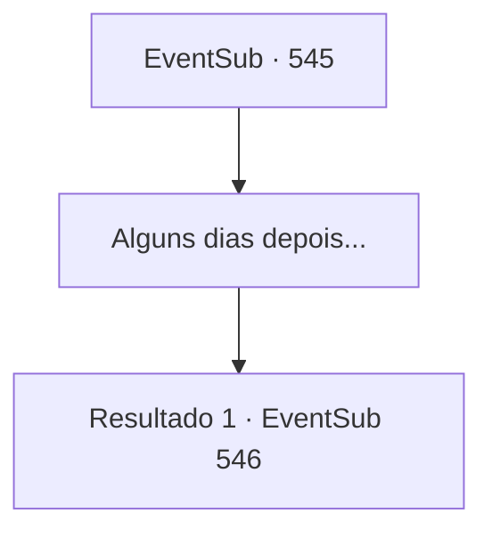

# Eventos secundários · 545

[Índice da tabela](index.md) · [Índice geral](../index.md)

ID: `pt:EventSub:545` · Fonte: `EventSub4` · Versão: 1.2.47.

Mapeamento estático dos arquivos; a disponibilidade e a execução dependem do estado da run.

## Texto do evento

*Sem texto no arquivo.*

## Dados de entrada

```json
{
  "id": 545,
  "grade": 1,
  "subEvent": "",
  "required": ""
}
```

## Mapa das escolhas



## Escolhas e resultados

### Escolha 1

Alguns dias depois...

Requisitos e outros campos da escolha:

```json
{
  "required": ""
}
```

#### Resultado 1.1

Depois de alguns dias, você chega mais uma vez em Antitikarr.  A mula está ofegante devido ao clima quente.  Você e Tess levam a mula perto do oásis.  

 "Ok, quem devemos procurar?"

  Em resposta à pergunta de Tess, você fala sobre o comerciante chamado 'Dowd'.  Tess responde com a testa franzida.  

 "Dowd... Esse é um nome muito popular aqui.  Já que você sabe como ele é, não temos outra opção senão procurar até você reconhecê-lo."

  Ela pergunta onde você quer começar a procurar.

Continuação registrada: [Evento 546](0546.md) na mesma tabela.

```json
{
  "required": "",
  "chance": "1",
  "nextEvent": 546,
  "type": 2,
  "reward": ""
}
```

## Referências que chegam a este evento

- [Evento 544 · escolha 2 · resultado 1](0544.md#escolha-2)
- [Evento 544 · escolha 3 · resultado 1](0544.md#escolha-3)
