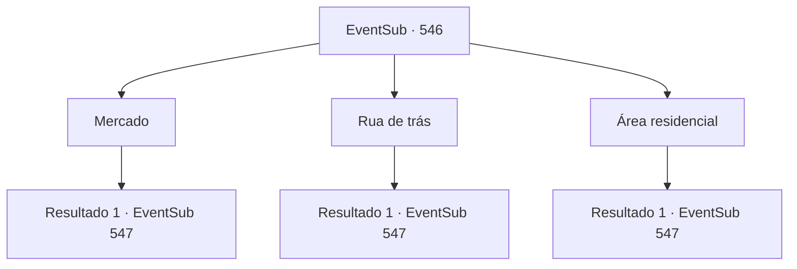

# Eventos secundários · 546

[Índice da tabela](index.md) · [Índice geral](../index.md)

ID: `pt:EventSub:546` · Fonte: `EventSub4` · Versão: 1.2.47.

Mapeamento estático dos arquivos; a disponibilidade e a execução dependem do estado da run.

## Texto do evento

*Sem texto no arquivo.*

## Dados de entrada

```json
{
  "id": 546,
  "grade": 1,
  "subEvent": "",
  "required": ""
}
```

## Mapa das escolhas



## Escolhas e resultados

### Escolha 1

Mercado

Requisitos e outros campos da escolha:

```json
{
  "required": ""
}
```

#### Resultado 1.1

Observas ao redor do mercado. As lojas estão cheias de tecidos com padrões coloridos, cerâmicas de bronze e ervas raras. Há todo tipo de coisas estranhas jogadas por aí. Os comerciantes tentam vender seus produtos te chamando toda vez que você olha suas mercadorias. 

 "100 moedas de ouro. Nah, espera um minuto. 80. Não, vou te dar por 70 moedas de ouro."

 Os comerciantes se agarram a você como mosquitos no meio do verão. Eles são muito irritantes. Depois de horas, você conclui que Dowd não está no mercado. Tess parece exausto. 

 "Oh, minha garganta. Preciso encontrar algo para beber."

 Ele corre direto para o bar mais próximo antes que você possa impedi-lo. 

 Tess abre a porta e quase colide com a pessoa que está saindo. É o 'Dowd' que você conheceu da última vez. Dowd te vê olhando para ele e seus olhos se abrem bem. Ele empurra Tess para o lado e começa a correr. 

 "O que... o que está acontecendo?"


Continuação registrada: [Evento 547](0547.md) na mesma tabela.

```json
{
  "required": "",
  "chance": "1",
  "nextEvent": 547,
  "type": 2,
  "reward": ""
}
```

### Escolha 2

Rua de trás

Requisitos e outros campos da escolha:

```json
{
  "required": ""
}
```

#### Resultado 2.1

Olhas ao redor da rua de trás. No estreito beco entre os prédios laranjas, há pousadas e bares lotados com pequenas placas. Apesar de teres olhado vários estabelecimentos, não consegues encontrar o Dowd. Tess parece exausta. 

 "Oh, minha garganta. Preciso encontrar algo para beber."

 Ele corre diretamente para o bar mais próximo antes que possas detê-lo. 

 Tess abre a porta e quase colide com a pessoa que está saindo. É o 'Dowd' que conheceste da última vez. Dowd vê-te olhando para ele e seus olhos se abrem bem. Ele empurra Tess para fora do caminho e começa a correr. 

 "O que... o que está acontecendo?"


Continuação registrada: [Evento 547](0547.md) na mesma tabela.

```json
{
  "required": "",
  "chance": "1",
  "nextEvent": 547,
  "type": 2,
  "reward": ""
}
```

### Escolha 3

Área residencial

Requisitos e outros campos da escolha:

```json
{
  "required": ""
}
```

#### Resultado 3.1

Você observa a área residencial. Crianças correm por um beco estreito entre os prédios laranjas, e roupas balançam no varal. Você e Tess se separam, perguntando por testemunhos de Dowd. No entanto, ninguém tem nenhuma informação. Tess parece exausto. 

 "Oh, minha garganta. Preciso encontrar algo para beber."

 Ele corre diretamente para o bar mais próximo antes que você possa impedi-lo.  Tess abre a porta e quase colide com a pessoa que está saindo. É o 'Dowd' que você conheceu da última vez. Dowd te vê olhando para ele, e seus olhos se abrem bem. Ele empurra Tess para fora do caminho e começa a correr. 

 "O que... o que está acontecendo?"


Continuação registrada: [Evento 547](0547.md) na mesma tabela.

```json
{
  "required": "",
  "chance": "1",
  "nextEvent": 547,
  "type": 2,
  "reward": ""
}
```

## Referências que chegam a este evento

- [Evento 545 · escolha 1 · resultado 1](0545.md#escolha-1)
