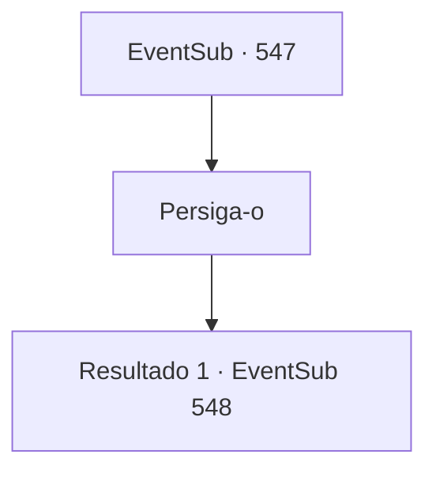

# Eventos secundários · 547

[Índice da tabela](index.md) · [Índice geral](../index.md)

ID: `pt:EventSub:547` · Fonte: `EventSub4` · Versão: 1.2.47.

Mapeamento estático dos arquivos; a disponibilidade e a execução dependem do estado da run.

## Texto do evento

*Sem texto no arquivo.*

## Dados de entrada

```json
{
  "id": 547,
  "grade": 1,
  "subEvent": "",
  "required": ""
}
```

## Mapa das escolhas



## Escolhas e resultados

### Escolha 1

Persiga-o

Requisitos e outros campos da escolha:

```json
{
  "required": ""
}
```

#### Resultado 1.1

Apanha o Dowd. 

 "Maldição... O que você quer?"

 Dowd grita para você, enquanto Tess se aproxima por trás e o golpeia. Dowd rola pelo chão com um grunhido. Tess se inclina e o agarra pelo pescoço. 

 "Minha filha... O que você fez com Sartha? Se apresse e me diga antes que eu transforme seu rosto em uma abóbora quebrada!"

 Dowd ri e agita as mãos. 

 "Kk... Acalme-se, Lord Radania. Um senhor não deveria ter uma atitude tão brusca... Sou um comerciante. Para que eu fale, vamos fazer um acordo."


Continuação registrada: [Evento 548](0548.md) na mesma tabela.

```json
{
  "required": "",
  "chance": "1",
  "nextEvent": 548,
  "type": 2,
  "reward": ""
}
```

## Referências que chegam a este evento

- [Evento 546 · escolha 1 · resultado 1](0546.md#escolha-1)
- [Evento 546 · escolha 2 · resultado 1](0546.md#escolha-2)
- [Evento 546 · escolha 3 · resultado 1](0546.md#escolha-3)
