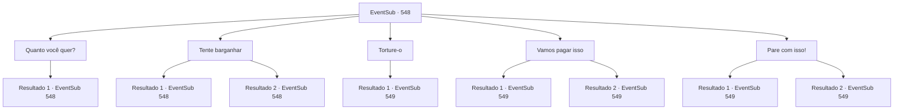

# Eventos secundários · 548

[Índice da tabela](index.md) · [Índice geral](../index.md)

ID: `pt:EventSub:548` · Fonte: `EventSub4` · Versão: 1.2.47.

Mapeamento estático dos arquivos; a disponibilidade e a execução dependem do estado da run.

## Texto do evento

*Sem texto no arquivo.*

## Dados de entrada

```json
{
  "id": 548,
  "grade": 1,
  "subEvent": "",
  "required": ""
}
```

## Mapa das escolhas



## Escolhas e resultados

### Escolha 1

Quanto você quer?

Requisitos e outros campos da escolha:

```json
{
  "required": "5_467_0"
}
```

#### Resultado 1.1

Em resposta à sua pergunta, Dowd levanta dois dedos e diz 200 de ouro.

Continuação registrada: [Evento 548](0548.md) na mesma tabela.

```json
{
  "required": "",
  "chance": "1",
  "nextEvent": 548,
  "type": 2,
  "reward": "5_467_1"
}
```

### Escolha 2

Tente barganhar

Requisitos e outros campos da escolha:

```json
{
  "required": "5_467_1|5_468_0"
}
```

#### Resultado 2.1

Tentando barganhar com Dowd. 

 "Hmm. Que tal 180 de ouro? Acho que isso me lembrará o que aconteceu com Sartha."

 Você franze a testa sem se impressionar. Ele te olha e continua urgentemente. 

 "Tudo bem. Eu te darei por 160 de ouro."

 Você balança a cabeça negativamente e tenta se virar. Mas Dowd te segura pelo ombro e fala novamente. 

 "Oh, eu... Vou te contar o que sei por 150 de ouro. Essa é minha última oferta."

 Quando Tess ouve isso, faz um bico e geme. 

 "Não posso acreditar que tenho que pagar ouro para esse sequestrador..."


Continuação registrada: [Evento 548](0548.md) na mesma tabela.

```json
{
  "required": "",
  "chance": "1|0_12_1",
  "nextEvent": 548,
  "type": 0,
  "reward": "5_468_2"
}
```

#### Resultado 2.2

Tentas negociar com Dowd. Mas Dowd é inflexível. 

 "Hmm... Se não forem 300, não acredito que consiga lembrar de qualquer informação sobre Sartha."

 Quando Tess ouve isso, faz um bico e reclama. 

 "Não posso acreditar que tenha que pagar ouro a esse sequestrador..."


Continuação registrada: [Evento 548](0548.md) na mesma tabela.

```json
{
  "required": "",
  "chance": "15",
  "nextEvent": 548,
  "type": 1,
  "reward": "5_468_1"
}
```

### Escolha 3

Torture-o

Requisitos e outros campos da escolha:

```json
{
  "required": "2_3_0"
}
```

#### Resultado 3.1

Você quer que Dowd entenda em que tipo de situação ele se encontra. Enquanto você quebra um de seus dedos, ele grita e uiva. <link=shake> 

 "Gritando! Você... maldita coisa! Maldito moleque!"

</link> Lentamente você mutila sua mão esquerda. Finalmente, Dowd começa a chorar e te chama de 'Senhor'. 

 "S, Senhor... Vou te contar tudo... Por favor, pare..."

 Tess puxa Dowd para que ele se levante. 

 "Levante-se. Nos leve para Sartha!"

 Você e Tess seguem Dowd para fora de Antitikarr e em direção ao deserto.

Continuação registrada: [Evento 549](0549.md) na mesma tabela.

```json
{
  "required": "",
  "chance": "1",
  "nextEvent": 549,
  "type": 2,
  "reward": "0_3_-1|5_469_1"
}
```

### Escolha 4

Vamos pagar isso

Requisitos e outros campos da escolha:

```json
{
  "required": "5_467_1"
}
```

#### Resultado 4.1

Tess seems unwilling, but she accepts the terms. 

 "I don't have that much gold at the moment, so take it to Radania and I'll pay you."

 He takes out a handkerchief with his initials embroidered in the corner, writes '200G' on it, and hands it to Dowd. Dowd puts the handkerchief in his pocket. 

 "Hmm... Alright. Sartha was sold to 'Ushuf'."

 According to Dowd, he is in the city of 'Vaziar', about three days' journey from here. He looks at you and continues. 

 "I will personally take you there."

 You and Tess follow Dowd towards the city of Vaziar.

Continuação registrada: [Evento 549](0549.md) na mesma tabela.

```json
{
  "required": "18_468_2",
  "chance": "1",
  "nextEvent": 549,
  "type": 2,
  "reward": ""
}
```

#### Resultado 4.2

Tess seems unwilling, but she accepts the terms. 

 "I don't have that much gold at the moment, so take it to Radania and I'll pay you."

 He takes out a handkerchief with his initials embroidered in the corner, writes '150G' on it, and hands it to Dowd. Dowd puts the handkerchief in his pocket. 

 "Hmm... Alright. Sartha was sold to 'Ushuf'."

 According to Dowd, he is in the city of 'Vaziar', about three days' journey from here. He looks at you and continues. 

 "I will personally take you there."

 You and Tess follow Dowd towards the city of Vaziar.

Continuação registrada: [Evento 549](0549.md) na mesma tabela.

```json
{
  "required": "5_468_2",
  "chance": "1",
  "nextEvent": 549,
  "type": 2,
  "reward": ""
}
```

### Escolha 5

Pare com isso!

Requisitos e outros campos da escolha:

```json
{
  "required": "5_467_1"
}
```

#### Resultado 5.1

Regañas em voz alta Dowd. Tess parece um pouco surpresa. 

 "Calma. Não tenho tanto ouro no momento, então leve-o para Radania e eu te pagarei."

 Ele tira um lenço com suas iniciais bordadas no canto, escreve '200G' e entrega a Dowd. Dowd guarda o lenço no bolso. 

 "Hmm... Tudo bem. Sartha foi vendida para 'Ushuf'."

 Segundo Dowd, ele está na cidade de 'Vaziar', a cerca de três dias de viagem daqui. Ele olha para você e continua. 

 "Eu te levarei pessoalmente até lá."

 Você e Tess seguem Dowd em direção à cidade de Vaziar.

Continuação registrada: [Evento 549](0549.md) na mesma tabela.

```json
{
  "required": "5_468_1",
  "chance": "1",
  "nextEvent": 549,
  "type": 2,
  "reward": ""
}
```

#### Resultado 5.2

Você repreende Dowd em voz alta. Tess parece um pouco surpresa. 

 "Calma. Não tenho tanto ouro no momento, então leve-o para Radania e eu te pagarei de volta."

 Ele tira um lenço com suas iniciais bordadas no canto, escreve '150G' e entrega a Dowd. Dowd guarda o lenço no bolso. 

 "Hmm... Tudo bem. Sartha foi vendida para 'Ushuf'."

 Segundo Dowd, ele está na cidade de 'Vaziar', a cerca de três dias de viagem daqui. Ele olha para você e continua. 

 "Eu te levarei pessoalmente até lá."

 Você e Tess seguem Dowd em direção à cidade de Vaziar.

Continuação registrada: [Evento 549](0549.md) na mesma tabela.

```json
{
  "required": "5_468_2",
  "chance": "1",
  "nextEvent": 549,
  "type": 2,
  "reward": ""
}
```

## Referências que chegam a este evento

- [Evento 547 · escolha 1 · resultado 1](0547.md#escolha-1)
- [Evento 548 · escolha 1 · resultado 1](0548.md#escolha-1)
- [Evento 548 · escolha 2 · resultado 1](0548.md#escolha-2)
- [Evento 548 · escolha 2 · resultado 2](0548.md#escolha-2)
