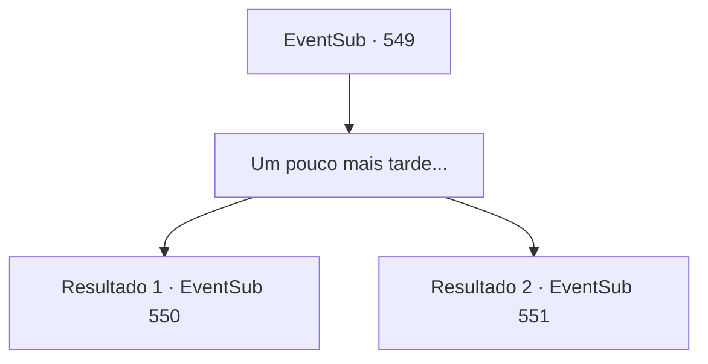

# Eventos secundários · 549

[Índice da tabela](index.md) · [Índice geral](../index.md)

ID: `pt:EventSub:549` · Fonte: `EventSub4` · Versão: 1.2.47.

Mapeamento estático dos arquivos; a disponibilidade e a execução dependem do estado da run.

## Texto do evento

*Sem texto no arquivo.*

## Dados de entrada

```json
{
  "id": 549,
  "grade": 1,
  "subEvent": "",
  "required": ""
}
```

## Mapa das escolhas



## Escolhas e resultados

### Escolha 1

Um pouco mais tarde...

Requisitos e outros campos da escolha:

```json
{
  "required": ""
}
```

#### Resultado 1.1

Enquanto você atravessa o deserto em um camelo, sente um tremor repentino no chão. Dowd murmura algo com uma expressão inquieta. 

 "Isso é..."

 Antes mesmo de terminar de falar, um gigantesco verme roxo salta da areia. Tess grita, empunhando sua gigantesca luva. 

 "Isso é incrível! Eu estava entediada. Vamos!"

 Ao contrário de Tess, que salta em direção ao verme roxo, Dowd começa a correr na direção oposta.

Continuação registrada: [Evento 550](0550.md) na mesma tabela.

```json
{
  "required": "5_469_1",
  "chance": "1",
  "nextEvent": 550,
  "type": 2,
  "reward": ""
}
```

#### Resultado 1.2

Enquanto você atravessa o deserto em um camelo, sente um tremor repentino no chão. Dowd fala com uma expressão nervosa. 

 "Espere. Todos, deitem-se no chão. Não queremos irritar o verme gigante na areia."


Continuação registrada: [Evento 551](0551.md) na mesma tabela.

```json
{
  "required": "18_469_1",
  "chance": "1",
  "nextEvent": 551,
  "type": 2,
  "reward": ""
}
```

## Referências que chegam a este evento

- [Evento 548 · escolha 3 · resultado 1](0548.md#escolha-3)
- [Evento 548 · escolha 4 · resultado 1](0548.md#escolha-4)
- [Evento 548 · escolha 4 · resultado 2](0548.md#escolha-4)
- [Evento 548 · escolha 5 · resultado 1](0548.md#escolha-5)
- [Evento 548 · escolha 5 · resultado 2](0548.md#escolha-5)
