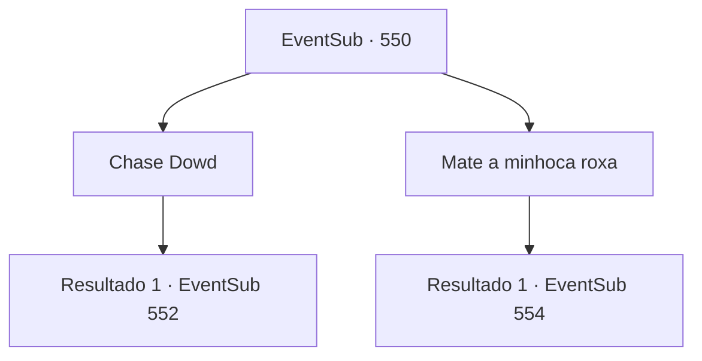

# Eventos secundários · 550

[Índice da tabela](index.md) · [Índice geral](../index.md)

ID: `pt:EventSub:550` · Fonte: `EventSub4` · Versão: 1.2.47.

Mapeamento estático dos arquivos; a disponibilidade e a execução dependem do estado da run.

## Texto do evento

*Sem texto no arquivo.*

## Dados de entrada

```json
{
  "id": 550,
  "grade": 1,
  "subEvent": "",
  "required": ""
}
```

## Mapa das escolhas



## Escolhas e resultados

### Escolha 1

Chase Dowd

Requisitos e outros campos da escolha:

```json
{
  "required": ""
}
```

#### Resultado 1.1

Você persegue a Dowd. Ela está correndo de forma estranha, balançando suas pernas. Isso a torna bastante fácil de alcançar. 

 "Argh! Vá embora! Se você vai morrer, faça isso sem mim."

 Em seguida, uma nuvem de areia se levanta na sua frente e outro verme roxo aparece. Ele engole a Dowd antes que você possa fazer algo a respeito. Isso não parece tê-lo satisfeito. O verme roxo ruge em sua direção.

Continuação registrada: [Evento 552](0552.md) na mesma tabela.

```json
{
  "required": "",
  "chance": "1",
  "nextEvent": 552,
  "type": 2,
  "reward": "6_3_86|5_470_1",
  "place": 5
}
```

### Escolha 2

Mate a minhoca roxa

Requisitos e outros campos da escolha:

```json
{
  "required": ""
}
```

#### Resultado 2.1

Você se une a Tess e luta contra a minhoca roxa. Ela abre a boca e grita, mostrando seus numerosos dentes.

Continuação registrada: [Evento 554](0554.md) na mesma tabela.

```json
{
  "required": "",
  "chance": "1",
  "nextEvent": 554,
  "type": 2,
  "reward": "6_0_86",
  "place": 5
}
```

## Referências que chegam a este evento

- [Evento 549 · escolha 1 · resultado 1](0549.md#escolha-1)
