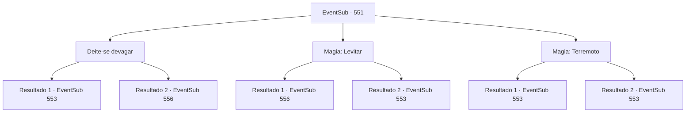

# Eventos secundários · 551

[Índice da tabela](index.md) · [Índice geral](../index.md)

ID: `pt:EventSub:551` · Fonte: `EventSub4` · Versão: 1.2.47.

Mapeamento estático dos arquivos; a disponibilidade e a execução dependem do estado da run.

## Texto do evento

*Sem texto no arquivo.*

## Dados de entrada

```json
{
  "id": 551,
  "grade": 1,
  "subEvent": "",
  "required": ""
}
```

## Mapa das escolhas



## Escolhas e resultados

### Escolha 1

Deite-se devagar

Requisitos e outros campos da escolha:

```json
{
  "required": ""
}
```

#### Resultado 1.1

Você desce do seu camelo e deita ao lado de Dowd, mas a areia está extremamente quente e você pula reflexivamente. Um momento depois, uma nuvem de areia se levanta e um gigantesco verme roxo emerge. Tess grita, empunhando sua luva gigante. 

 "Isso é incrível! Eu estava entediada. Vamos lá!"

 Por outro lado, Dowd parece estar congelado de terror.

Continuação registrada: [Evento 553](0553.md) na mesma tabela.

```json
{
  "required": "",
  "chance": "14",
  "nextEvent": 553,
  "type": 1,
  "reward": "6_0_86",
  "place": 5
}
```

#### Resultado 1.2

Você desce do seu camelo e deita ao lado de Dowd. A areia está escaldante, mas você consegue ficar quieto. A vibração para depois de um tempo. 

 "Acho que ele já foi embora."

 Dowd se levanta, dizendo que a minhoca parece ter ido embora. Sua testa e pescoço já estão encharcados de suor. 

 "Oh meu Deus... eu teria virado carne assada se tivesse ficado um pouco mais nessa areia."

 Tess também se levanta, resmungando. 

 "Não falta muito. Vamos nos apressar."

 Os três continuam sua jornada em direção a Vaziar.

Continuação registrada: [Evento 556](0556.md) na mesma tabela.

```json
{
  "required": "",
  "chance": "1|0_13_1",
  "nextEvent": 556,
  "type": 0,
  "reward": ""
}
```

### Escolha 2

Magia: Levitar

Requisitos e outros campos da escolha:

```json
{
  "required": "20_0_1"
}
```

#### Resultado 2.1

Lanças um feitiço e tu, Dowd e Tess, todos levantam no ar. Esperas um pouco até que a vibração se acalme. 

 "Oh... Não sabia que eras um mago. Não pareces um. De qualquer forma, acho que a minhoca já foi embora agora, então por favor me devolva ao chão."

 Baixas lentamente todos novamente. Os três continuam sua jornada em direção a Vaziar.

Continuação registrada: [Evento 556](0556.md) na mesma tabela.

```json
{
  "required": "",
  "chance": "1|0_7_1|0_12_1",
  "nextEvent": 556,
  "type": 0,
  "reward": ""
}
```

#### Resultado 2.2

Lanças o feitiço, mas perdes o teu foco. Um momento depois, uma pilha de areia se levanta e emerge uma gigantesca minhoca roxa. Tess grita, empunhando sua gigantesca manopla. 

 "Isso é incrível! Eu estava entediada. Vamos!"

 Por outro lado, Dowd parece estar congelado de terror.

Continuação registrada: [Evento 553](0553.md) na mesma tabela.

```json
{
  "required": "",
  "chance": "20",
  "nextEvent": 553,
  "type": 1,
  "reward": "6_0_86",
  "place": 5
}
```

### Escolha 3

Magia: Terremoto

Requisitos e outros campos da escolha:

```json
{
  "required": "20_0_4|1_0_2"
}
```

#### Resultado 3.1

Você concentra sua mente e começa a sacudir a terra. <link=shake>'¡Kugugugu!!'</link> A areia treme com um estrondo tremendo, e um enorme verme roxo emerge. Todo o seu corpo se contorce, derramando fluidos corporais verdes e lamacentos. Tess grita, empunhando sua luva gigante. 

 "Isso é incrível! Eu estava entediada. Vamos lá!"

 Por outro lado, Dowd parece estar congelado de terror.

Continuação registrada: [Evento 553](0553.md) na mesma tabela.

```json
{
  "required": "",
  "chance": "1|0_7_1|0_12_1",
  "nextEvent": 553,
  "type": 0,
  "reward": "6_2_86|0_1_-1",
  "place": 5
}
```

#### Resultado 3.2

Lanças o feitiço, mas perdes o teu foco. Um momento depois, uma pilha de areia se levanta e emerge uma gigantesca minhoca roxa. Tess grita, empunhando sua gigantesca manopla. 

 "Isso é incrível! Eu estava entediada. Vamos!"

 Por outro lado, Dowd parece estar congelado de terror.

Continuação registrada: [Evento 553](0553.md) na mesma tabela.

```json
{
  "required": "",
  "chance": "26",
  "nextEvent": 553,
  "type": 1,
  "reward": "6_0_86|0_1_-1",
  "place": 5
}
```

## Referências que chegam a este evento

- [Evento 549 · escolha 1 · resultado 2](0549.md#escolha-1)
