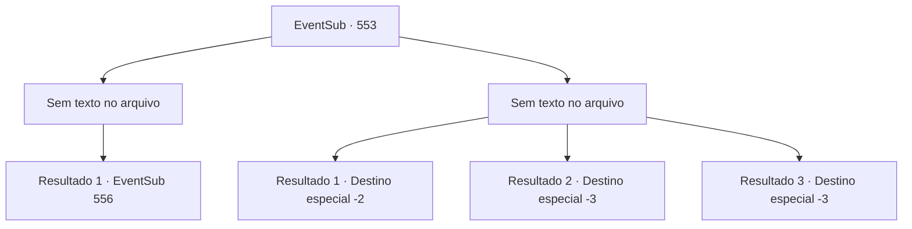

# Eventos secundários · 553

[Índice da tabela](index.md) · [Índice geral](../index.md)

ID: `pt:EventSub:553` · Fonte: `EventSub4` · Versão: 1.2.47.

Mapeamento estático dos arquivos; a disponibilidade e a execução dependem do estado da run.

## Texto do evento

*Sem texto no arquivo.*

## Dados de entrada

```json
{
  "id": 553,
  "grade": 1,
  "subEvent": "",
  "required": ""
}
```

## Mapa das escolhas



## Escolhas e resultados

### Escolha 1

*Sem texto no arquivo; o papel dessa opção depende da interface do jogo.*

Requisitos e outros campos da escolha:

```json
{
  "required": ""
}
```

#### Resultado 1.1

Você mata a minhoca roxa, e Dowd admira sua força com os olhos abertos. 

 "Isso... Você é incrível, pessoal. Graças a vocês, estou vivo"

 Tess responde, acenando com a mão. 

 "Fico feliz que você saiba disso agora. Vamos encontrar minha filha."

 Tess segue à frente com um salto em seu passo.

Continuação registrada: [Evento 556](0556.md) na mesma tabela.

```json
{
  "required": "",
  "chance": "1",
  "nextEvent": 556,
  "type": 2,
  "reward": ""
}
```

### Escolha 2

*Sem texto no arquivo; o papel dessa opção depende da interface do jogo.*

Requisitos e outros campos da escolha:

```json
{
  "required": ""
}
```

#### Resultado 2.1

O verme roxo bate em você com seu corpo enorme. Enquanto o verme ruge, a dor se espalha por todo o seu corpo e você perde a consciência. 

 Você se levanta da areia, ofegante. O sol já se pôs e um vento frio sopra. Você não consegue ver para onde o verme roxo foi e Tess e Dowd não estão em lugar nenhum. Você não pode mais continuar com esta missão porque não sabe para onde eles foram.

Continuação registrada: [Destino especial `-2`](../destinos-especiais.md).

```json
{
  "required": "1_0_2|1_1_2",
  "chance": "1",
  "nextEvent": -2,
  "type": 2,
  "reward": "12_9_-1|14_9_12|0_0_-1|0_1_-1"
}
```

#### Resultado 2.2

O verme roxo colide contra você com seu corpo enorme. Enquanto o verme ruge, a dor se espalha por todo o seu corpo e você perde a consciência.

Continuação registrada: [Destino especial `-3`](../destinos-especiais.md).

```json
{
  "required": "2_0_2",
  "chance": "1",
  "nextEvent": -3,
  "type": 2,
  "reward": "0_0_-1|0_1_-1"
}
```

#### Resultado 2.3

O verme roxo colide contra você com seu corpo enorme. Enquanto o verme ruge, a dor se espalha por todo o seu corpo e você perde a consciência.

Continuação registrada: [Destino especial `-3`](../destinos-especiais.md).

```json
{
  "required": "2_1_2",
  "chance": "1",
  "nextEvent": -3,
  "type": 2,
  "reward": "0_0_-1|0_1_-1"
}
```

## Referências que chegam a este evento

- [Evento 551 · escolha 1 · resultado 1](0551.md#escolha-1)
- [Evento 551 · escolha 2 · resultado 2](0551.md#escolha-2)
- [Evento 551 · escolha 3 · resultado 1](0551.md#escolha-3)
- [Evento 551 · escolha 3 · resultado 2](0551.md#escolha-3)
