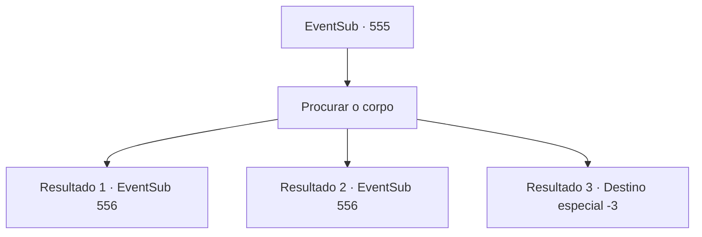

# Eventos secundários · 555

[Índice da tabela](index.md) · [Índice geral](../index.md)

ID: `pt:EventSub:555` · Fonte: `EventSub4` · Versão: 1.2.47.

Mapeamento estático dos arquivos; a disponibilidade e a execução dependem do estado da run.

## Texto do evento

*Sem texto no arquivo.*

## Dados de entrada

```json
{
  "id": 555,
  "grade": 1,
  "subEvent": "",
  "required": ""
}
```

## Mapa das escolhas



## Escolhas e resultados

### Escolha 1

Procurar o corpo

Requisitos e outros campos da escolha:

```json
{
  "required": ""
}
```

#### Resultado 1.1

Você examina o corpo de Dowd, que está coberto de sucos digestivos. Cheira horrível, mas você aguenta o suficiente para procurar em sua bolsa. Você encontra um caderno que ele estava usando. O caderno detalha seu extenso trabalho de sequestrar e vender pessoas. Você não percebeu que ele se aproximou, mas Tess está parado sobre você. Sua luva está pingando com líquido verde. 

 "Faz tempo que não luto assim, então me sinto rígido. Hmm? O que é isso?"

 Ele pega o livro das suas mãos e olha o conteúdo. 

 "São os detalhes das transações! Ele escreveu onde vendeu seus cativos. Onde... Sartha... está aqui! 'Ushuf de Vaziar' comprou ela. Precisamos nos apressar e ir para Vaziar!"

 Tess assume a liderança com um salto em seu passo.

Continuação registrada: [Evento 556](0556.md) na mesma tabela.

```json
{
  "required": "",
  "chance": "1|0_13_1",
  "nextEvent": 556,
  "type": 0,
  "reward": ""
}
```

#### Resultado 1.2

Você examina o corpo de Dowd, que está coberto de sucos digestivos. Um cheiro terrível enche o seu nariz. Você recua cambaleando. É tão repugnante que você não consegue suportar. 

 "Eu farei."

 Tess procura o corpo por si mesma e encontra um caderno na pessoa de Dowd. 

 "São os detalhes da transação! Ele escreveu onde vendeu seus cativos. Onde... Sartha... está aqui! 'Ushuf de Vaziar' comprou. Devemos nos apressar e ir para Vaziar!"

 Tess segue à frente com um salto em seu passo.

Continuação registrada: [Evento 556](0556.md) na mesma tabela.

```json
{
  "required": "1_1_2",
  "chance": "14",
  "nextEvent": 556,
  "type": 1,
  "reward": "0_1_-1"
}
```

#### Resultado 1.3

Você examina o corpo de Dowd, que está coberto de sucos digestivos. Um cheiro terrível enche seu nariz e você desmaia em uma tontura repentina.

Continuação registrada: [Destino especial `-3`](../destinos-especiais.md).

```json
{
  "required": "2_1_2",
  "chance": "14",
  "nextEvent": -3,
  "type": 1,
  "reward": "0_1_-1"
}
```

## Referências que chegam a este evento

- [Evento 552 · escolha 1 · resultado 1](0552.md#escolha-1)
- [Evento 554 · escolha 1 · resultado 1](0554.md#escolha-1)
