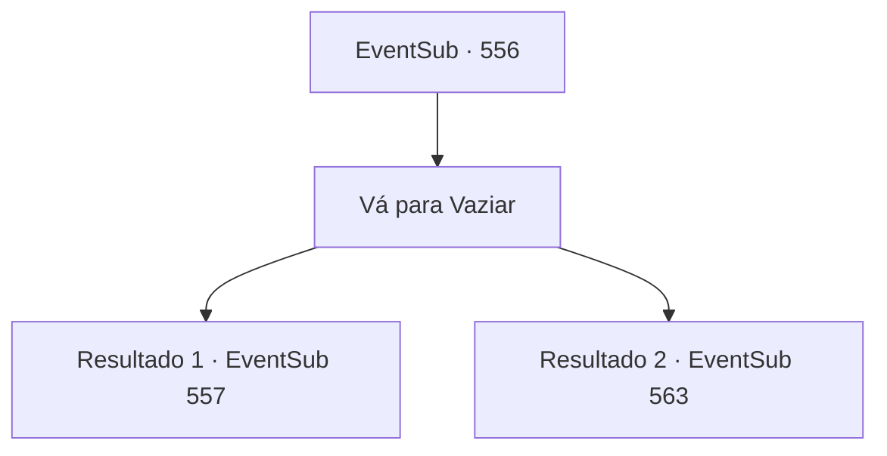

# Eventos secundários · 556

[Índice da tabela](index.md) · [Índice geral](../index.md)

ID: `pt:EventSub:556` · Fonte: `EventSub4` · Versão: 1.2.47.

Mapeamento estático dos arquivos; a disponibilidade e a execução dependem do estado da run.

## Texto do evento

*Sem texto no arquivo.*

## Dados de entrada

```json
{
  "id": 556,
  "grade": 1,
  "subEvent": "",
  "required": ""
}
```

## Mapa das escolhas



## Escolhas e resultados

### Escolha 1

Vá para Vaziar

Requisitos e outros campos da escolha:

```json
{
  "required": ""
}
```

#### Resultado 1.1

Você passa pelo deserto e finalmente chega à cidade costeira de Vaziar. Localizada em uma baía tranquila com poucas ondas, Vaziar é uma cidade comercial lotada de vários navios de comércio. |drawing_vaziar| Tecidos bordados de forma chamativa pendem sobre os prédios. Encontrar um lugar tranquilo para conversar é bastante difícil devido aos comerciantes por toda parte. Tess está absorvendo tudo e murmurando para si mesmo. 

 "Oh meu Deus... Tem tanta gente. Nunca estive em um lugar como este nos meus 150 anos de vida."

 Então ele dá um tapa na bochecha e fala novamente. 

 "Não, precisamos encontrar Ushuf. Se apresse e procure informações!"

 Ele se abre caminho entre a multidão e começa a perguntar aos comerciantes onde está Ushuf.

Continuação registrada: [Evento 557](0557.md) na mesma tabela.

```json
{
  "required": "5_470_1",
  "chance": "1",
  "nextEvent": 557,
  "type": 2,
  "reward": ""
}
```

#### Resultado 1.2

Você passa pelo deserto e finalmente chega à cidade costeira de Vaziar. Localizada em uma baía tranquila com poucas ondas, Vaziar é uma cidade comercial lotada de vários navios de comércio. |drawing_vaziar| Tecidos bordados de forma chamativa pendem sobre os prédios. Encontrar um lugar tranquilo para conversar é bastante difícil devido aos comerciantes por toda parte. Tess está absorvendo tudo e murmurando para si mesmo. 

 "Oh meu Deus... Tem tanta gente. Nunca estive em um lugar como este nos meus 150 anos de vida."

 Dowd o agarra pelo ombro. 

 "Vê aquilo? Aquela casa azul ali."

 Seguindo o dedo apontador de Dowd, você pode ver uma casa decorada com azulejos azuis. Azulejos com padrões coloridos e complexos cobrem todo o prédio, e há uma cúpula dourada no topo. 

 "Oh meu Deus... Aquela é uma casa?"

 Tess engole em seco enquanto olha para o prédio que é muito mais colorido do que seu palácio. Dowd assente. 

 "Vamos."


Continuação registrada: [Evento 563](0563.md) na mesma tabela.

```json
{
  "required": "18_470_1",
  "chance": "1",
  "nextEvent": 563,
  "type": 2,
  "reward": ""
}
```

## Referências que chegam a este evento

- [Evento 551 · escolha 1 · resultado 2](0551.md#escolha-1)
- [Evento 551 · escolha 2 · resultado 1](0551.md#escolha-2)
- [Evento 553 · escolha 1 · resultado 1](0553.md#escolha-1)
- [Evento 555 · escolha 1 · resultado 1](0555.md#escolha-1)
- [Evento 555 · escolha 1 · resultado 2](0555.md#escolha-1)
