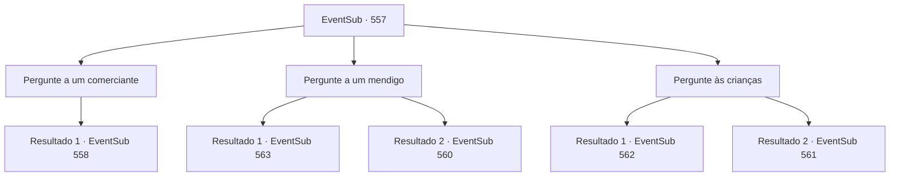

# Eventos secundários · 557

[Índice da tabela](index.md) · [Índice geral](../index.md)

ID: `pt:EventSub:557` · Fonte: `EventSub4` · Versão: 1.2.47.

Mapeamento estático dos arquivos; a disponibilidade e a execução dependem do estado da run.

## Texto do evento

*Sem texto no arquivo.*

## Dados de entrada

```json
{
  "id": 557,
  "grade": 1,
  "subEvent": "",
  "required": ""
}
```

## Mapa das escolhas



## Escolhas e resultados

### Escolha 1

Pergunte a um comerciante

Requisitos e outros campos da escolha:

```json
{
  "required": ""
}
```

#### Resultado 1.1

Você se aproxima de um comerciante que vende uma variedade de bens diversos e pergunta onde fica a casa de Ushuf. Ele te olha e diz com um sorriso. 

 "50 de ouro."


Continuação registrada: [Evento 558](0558.md) na mesma tabela.

```json
{
  "required": "",
  "chance": "1",
  "nextEvent": 558,
  "type": 2,
  "reward": ""
}
```

### Escolha 2

Pergunte a um mendigo

Requisitos e outros campos da escolha:

```json
{
  "required": ""
}
```

#### Resultado 2.1

Você se aproxima de um mendigo sentado no chão e pergunta onde fica a casa de Ushuf. O mendigo olha para você, levemente surpreso. 

 "Lá... A casa azul na praia!"

 Ele está assustado e quase chora. Você olha na direção que o mendigo está apontando. Lá você pode ver uma casa decorada com azulejos azuis. Azulejos com padrões coloridos e complexos cobrem todo o prédio, e há uma cúpula dourada no topo. Você conta a Tess as informações que encontrou. Ele estava discutindo com um comerciante, mas quando te ouve, responde com um sorriso. 

 "Ufa. Ainda bem. Estou com dor de cabeça lidando com esse idiota."

 Tess assume a liderança e eles vão para a casa de Ushuf.

Continuação registrada: [Evento 563](0563.md) na mesma tabela.

```json
{
  "required": "20_1_2",
  "chance": "1",
  "nextEvent": 563,
  "type": 2,
  "reward": ""
}
```

#### Resultado 2.2

Você se aproxima de um mendigo sentado no chão e pergunta onde fica a casa de Ushuf. O mendigo olha para você e responde com um sorriso. 

 "Hmm... Se você demonstrar sinceridade, talvez eu pense sobre isso...?"


Continuação registrada: [Evento 560](0560.md) na mesma tabela.

```json
{
  "required": "21_1_2",
  "chance": "1",
  "nextEvent": 560,
  "type": 2,
  "reward": ""
}
```

### Escolha 3

Pergunte às crianças

Requisitos e outros campos da escolha:

```json
{
  "required": ""
}
```

#### Resultado 3.1

Você caminha em direção a algumas crianças que estão brincando com uma bola no beco e pergunta onde fica a casa de Ushuf. As crianças se assustam e saem correndo chorando. Você volta para Tess. Ele disse que conseguiria informações dos comerciantes, mas está no meio de uma discussão com um. 

 "Você é um trapaceiro!"

 Segundo Tess, ele pagou 50 moedas de ouro a um comerciante para comprar informações. Então outro comerciante ao lado disse que só teria cobrado 10 moedas de ouro por isso. Tess se vira dizendo que foi enganado.

Continuação registrada: [Evento 562](0562.md) na mesma tabela.

```json
{
  "required": "20_1_2",
  "chance": "1",
  "nextEvent": 562,
  "type": 2,
  "reward": ""
}
```

#### Resultado 3.2

Você se aproxima de algumas crianças que estão brincando com uma bola no beco e pergunta onde fica a casa de Ushuf.  As crianças riem e respondem. 

 "Bem... Se você brincar com a gente, talvez a gente lembre."


Continuação registrada: [Evento 561](0561.md) na mesma tabela.

```json
{
  "required": "21_1_2",
  "chance": "1",
  "nextEvent": 561,
  "type": 2,
  "reward": ""
}
```

## Referências que chegam a este evento

- [Evento 556 · escolha 1 · resultado 1](0556.md#escolha-1)
