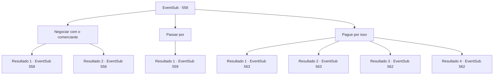

# Eventos secundários · 558

[Índice da tabela](index.md) · [Índice geral](../index.md)

ID: `pt:EventSub:558` · Fonte: `EventSub4` · Versão: 1.2.47.

Mapeamento estático dos arquivos; a disponibilidade e a execução dependem do estado da run.

## Texto do evento

*Sem texto no arquivo.*

## Dados de entrada

```json
{
  "id": 558,
  "grade": 1,
  "subEvent": "",
  "required": ""
}
```

## Mapa das escolhas



## Escolhas e resultados

### Escolha 1

Negociar com o comerciante

Requisitos e outros campos da escolha:

```json
{
  "required": "5_471_0"
}
```

#### Resultado 1.1

Você negocia com o comerciante para obter um preço melhor. Depois de uma longa conversa, o comerciante finalmente cede. 

 "Então... 30 moedas de ouro. Não posso baixar mais do que isso."


Continuação registrada: [Evento 558](0558.md) na mesma tabela.

```json
{
  "required": "",
  "chance": "1|0_12_1",
  "nextEvent": 558,
  "type": 0,
  "reward": "5_471_2"
}
```

#### Resultado 1.2

Tentas negociar com um comerciante, mas ele não cede. 

 "Não tenho motivo para baixar meus preços."

 Ele diz que não te dará informações a menos que pagues 50 moedas de ouro.

Continuação registrada: [Evento 558](0558.md) na mesma tabela.

```json
{
  "required": "",
  "chance": "20",
  "nextEvent": 558,
  "type": 1,
  "reward": "5_471_1"
}
```

### Escolha 2

Passar por

Requisitos e outros campos da escolha:

```json
{
  "required": ""
}
```

#### Resultado 2.1

Você desiste e tenta se afastar do comerciante. Então ele agarra seu braço e faz outra oferta. 

 "Vamos lá... Apenas 30. Eu só preciso de 30 moedas de ouro."


Continuação registrada: [Evento 559](0559.md) na mesma tabela.

```json
{
  "required": "",
  "chance": "1",
  "nextEvent": 559,
  "type": 2,
  "reward": "5_471_2"
}
```

### Escolha 3

Pague por isso

Requisitos e outros campos da escolha:

```json
{
  "required": ""
}
```

#### Resultado 3.1

Você paga o ouro ao comerciante. Ele pega o ouro, guarda no bolso e te diz onde fica a casa de Ushuf. 

 "Ali. Você consegue ver a mansão azul na praia? Aquela é a residência de Ushuf."

 Você olha na direção em que o comerciante está apontando. Lá você pode ver uma casa decorada com azulejos azuis. Azulejos com padrões coloridos e complexos cobrem todo o prédio, e há uma cúpula dourada no topo. Você conta a Tess as informações que encontrou. Ele estava discutindo com um comerciante, mas quando te ouve, responde com um sorriso. 

 "Ufa. Ainda bem. Estou com dor de cabeça lidando com esse idiota."

 Tess toma a frente e eles vão para a casa de Ushuf.

Continuação registrada: [Evento 563](0563.md) na mesma tabela.

```json
{
  "required": "18_471_2|1_4_50",
  "chance": "1",
  "nextEvent": 563,
  "type": 2,
  "reward": "0_4_-50"
}
```

#### Resultado 3.2

Você paga o ouro ao comerciante. Ele pega o ouro, guarda no bolso e te diz onde fica a casa de Ushuf. 

 "Ali. Você consegue ver a mansão azul na praia? Aquela é a residência de Ushuf."

 Você olha na direção em que o comerciante está apontando. Lá você pode ver uma casa decorada com azulejos azuis. Azulejos com padrões coloridos e complexos cobrem todo o prédio, e há uma cúpula dourada no topo. Você conta a Tess as informações que encontrou. Ele estava discutindo com um comerciante, mas quando te ouve, responde com um sorriso. 

 "Ufa. Ainda bem. Estou com dor de cabeça lidando com esse idiota."

 Tess toma a frente e eles vão para a casa de Ushuf.

Continuação registrada: [Evento 563](0563.md) na mesma tabela.

```json
{
  "required": "5_471_2|1_4_30",
  "chance": "1",
  "nextEvent": 563,
  "type": 2,
  "reward": "0_4_-30"
}
```

#### Resultado 3.3

Você vai pagar ouro e comprar informações. Mas você não tem ouro suficiente no seu bolso. Você vai procurar Tess, deixando o comerciante para trás. Ele disse que também obteria informações dos comerciantes, mas está no meio de uma discussão com um. 

 "Você é um trapaceiro!"

 Segundo Tess, ela pagou 50 de ouro a um comerciante para comprar informações. Então outro comerciante ao lado disse que só teria cobrado 10 de ouro por isso. Tess se vira, dizendo que foi enganada.

Continuação registrada: [Evento 562](0562.md) na mesma tabela.

```json
{
  "required": "18_471_2|2_4_50",
  "chance": "1",
  "nextEvent": 562,
  "type": 2,
  "reward": ""
}
```

#### Resultado 3.4

Você vai pagar ouro e comprar informações. Mas você não tem ouro suficiente no seu bolso. Você vai procurar Tess, deixando o comerciante para trás. Ele disse que também obteria informações dos comerciantes, mas está no meio de uma discussão com um. 

 "Você é um trapaceiro!"

 Segundo Tess, ela pagou 50 de ouro a um comerciante para comprar informações. Então outro comerciante ao lado disse que só teria cobrado 10 de ouro por isso. Tess se vira, dizendo que foi enganada.

Continuação registrada: [Evento 562](0562.md) na mesma tabela.

```json
{
  "required": "5_471_2|2_4_30",
  "chance": "1",
  "nextEvent": 562,
  "type": 2,
  "reward": ""
}
```

## Referências que chegam a este evento

- [Evento 557 · escolha 1 · resultado 1](0557.md#escolha-1)
- [Evento 558 · escolha 1 · resultado 1](0558.md#escolha-1)
- [Evento 558 · escolha 1 · resultado 2](0558.md#escolha-1)
