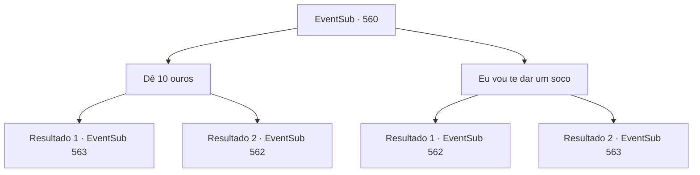

# Eventos secundários · 560

[Índice da tabela](index.md) · [Índice geral](../index.md)

ID: `pt:EventSub:560` · Fonte: `EventSub4` · Versão: 1.2.47.

Mapeamento estático dos arquivos; a disponibilidade e a execução dependem do estado da run.

## Texto do evento

*Sem texto no arquivo.*

## Dados de entrada

```json
{
  "id": 560,
  "grade": 1,
  "subEvent": "",
  "required": ""
}
```

## Mapa das escolhas



## Escolhas e resultados

### Escolha 1

Dê 10 ouros

Requisitos e outros campos da escolha:

```json
{
  "required": ""
}
```

#### Resultado 1.1

Você entrega algumas poucas moedas de ouro ao mendigo. Ele sorri, mostrando seus dentes amarelos. Em seguida, ele aponta para uma mansão azul na costa. 

 "Lá. Aquela é a mansão de Ushuf. Sim, hehe..."

 Você olha na direção em que o mendigo está apontando. Lá você pode ver uma casa decorada com azulejos azuis. Azulejos com padrões coloridos e complexos cobrem todo o prédio, e há uma cúpula dourada no topo. Você conta a Tess as informações que encontrou. Ele estava discutindo com um comerciante, mas quando te ouve, responde com um sorriso. 

 "Ufa. Isso é um alívio. Estou com dor de cabeça lidando com esse idiota."

 Tess toma a frente e eles vão para a casa de Ushuf.

Continuação registrada: [Evento 563](0563.md) na mesma tabela.

```json
{
  "required": "1_4_10",
  "chance": "1",
  "nextEvent": 563,
  "type": 2,
  "reward": ""
}
```

#### Resultado 1.2

Você vai pagar ouro e comprar informações. Mas você não tem ouro suficiente no seu bolso. Você vai procurar Tess, deixando o mendigo para trás. Ele disse que obteria informações dos comerciantes, mas está no meio de uma discussão com um. 

 "Você é um trapaceiro!"

 Segundo Tess, ela pagou 50 moedas de ouro a um comerciante para comprar certas informações. Então outro comerciante ao lado dele disse que só teria cobrado 10 moedas de ouro por isso. Tess se vira, dizendo que foi enganada.

Continuação registrada: [Evento 562](0562.md) na mesma tabela.

```json
{
  "required": "2_4_10",
  "chance": "1",
  "nextEvent": 562,
  "type": 2,
  "reward": ""
}
```

### Escolha 2

Eu vou te dar um soco

Requisitos e outros campos da escolha:

```json
{
  "required": "2_3_0"
}
```

#### Resultado 2.1

Você dá um soco no mendigo no rosto. Você pode ter batido nele com muita força, pois ele desmaia. Você o apoia contra a parede e volta para Tess. Ele disse que obteria informações dos comerciantes, mas está no meio de uma discussão com um. 

 "Você é um trapaceiro!"

 Segundo Tess, ele pagou 50 moedas de ouro a um comerciante para comprar certas informações. Então, outro comerciante ao lado disse que teria cobrado apenas 10 moedas de ouro por isso. Tess se vira, dizendo que foi enganado.

Continuação registrada: [Evento 562](0562.md) na mesma tabela.

```json
{
  "required": "",
  "chance": "1|0_5_1",
  "nextEvent": 562,
  "type": 1,
  "reward": ""
}
```

#### Resultado 2.2

Você mostra sua sinceridade com seu punho. Depois de bater nele várias vezes, o mendigo está à beira das lágrimas. 

 "Lá... Está lá. É aquele prédio azul..."

 Você olha na direção em que o mendigo está apontando. Lá você pode ver uma casa decorada com azulejos azuis. Azulejos com padrões coloridos e complexos cobrem todo o prédio, e há uma cúpula dourada no topo. Você conta a Tess as informações que encontrou. Ele estava brigando com um comerciante, mas quando te ouve, responde com um sorriso. 

 "Ufa. Que alívio. Estou com dor de cabeça tentando lidar com esse idiota."

 Tess toma a frente e eles vão para a casa de Ushuf.

Continuação registrada: [Evento 563](0563.md) na mesma tabela.

```json
{
  "required": "",
  "chance": "15",
  "nextEvent": 563,
  "type": 0,
  "reward": ""
}
```

## Referências que chegam a este evento

- [Evento 557 · escolha 2 · resultado 2](0557.md#escolha-2)
